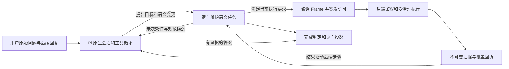

# Pi 语义任务统一改造

本次改造保留 Pi 作为唯一 Agent 核心，把易变的用户表达和可信执行参数分开：Pi 解释目标、提出变更、选择工具并根据结果调整计划；宿主维护同一 Session 中的任务状态，将通过校验的步骤编译成 Frame，后端执行受治理查询。用户输入不需要符合固定句式，模型也不再填写内部指标索引、原文证明、预计数量或状态版本。

当前新建会话缺省使用 `semantic_v2`，可由 `AGENT_BUSINESS_PROTOCOL` 配置为 `fixed_v1`；已有会话继续使用 Session 中保存的协议。通用多轮上下文、Pi 目标澄清和内部状态变更见[当前实现及兼容边界](implementation-multiturn-context.md)，实际验收见[本轮验证目录](../verification/generic-multiturn-context-20261015/)。大于 95% 是独立实际问法样本上的验收目标，不是当前已证明的结果。

此前阶段记录保留为历史证据：[阶段二](implementation-phase2.md)、[阶段三](implementation-phase3.md)、[阶段四](implementation-phase4.md)。其中“候选入口、尚未切换”等描述对应当时状态，不覆盖当前实现与配置。

## 当前链路与改造链路

当前版本 2 链路为原始用户消息 → Pi 原生 Session 和工具循环 → `resolve_business_turn` 的 `source + operations` → 宿主规范字段与独立任务准入 → Frame 与执行许可 → 后端受治理接口 → 同一 Pi 继续规划或回答 → 页面及历史投影。旧版本 1 会话仍由绑定的旧协议处理。

新链路在同一循环中加入语义任务、完整目标义务及步骤执行许可。明确完整查询可以一次提交语义提议，宿主完成绑定和许可校验后直接执行；分析请求可以按证据增加步骤。目录探索、Skill 读取和可用性查询由 Pi 按需选择，不成为每次查询的固定前置流程。



这张图描述当前版本 2 的职责边界。默认入口配置与运行验收分别记录；切换不代表全部场景已通过。任务领域值不是另一份消息历史，宿主不会在 Pi 前再运行一个理解或规划 Agent。

## 职责边界

| 层 | 保留和承担的职责 | 需要调整的边界 |
| --- | --- | --- |
| Pi | 原始语言理解、历史语义、目录和 Skill 选择、目标拆分、步骤选择、结果驱动重规划、答案组织 | 公开工具只接受一种版本 2 提议格式；从反馈中修正语义，不编造代码或执行证明 |
| 宿主领域层 | Session 事务、目录与来源绑定、日期计算、完整目标、版本依赖、许可和幂等登记 | Frame 从完整任务的替代品变成步骤编译快照；有效和未决变更都保留 |
| 后端 | 当前身份与权限、合法目录、物理查询、计算约束、数据覆盖和正式结果 | 接受已校验的执行契约；继续独立复核，不能信任模型的数量、排除或成功声明 |
| 页面和历史 | 展示执行过程、正式答案与可恢复状态 | 运行结束、任务完成、等待澄清、取消和结果未知分别呈现，最终快照覆盖临时状态 |

宿主无法确定业务含义时，返回具体未决字段及原因，让同一 Pi 继续解释，或让用户作必要选择。语义提议未通过校验时不会执行；可恢复字段保留在任务中，不能通过省略错误字段继承旧值来绕过本轮修改。

## 已确定的契约

- [公开协议](protocol.md)、[参数 Schema](request.schema.json) 和 [请求样例](request-examples.json)：必填根字段为 `protocol_version`、`intent`、`targets`，可选 `context_action` 明确续接、暂缓或放弃待澄清修改；初始输入与修改统一使用目标内的 `operations`。
- [工具反馈与引用](feedback.md)、[反馈 Schema](feedback.schema.json) 和 [状态样例](feedback-examples.json)：统一诊断、保存状态、任务完成度、接续责任，以及引用签发、修订和恢复规则。
- [任务状态与执行](state-and-execution.md)：目标绑定、未决提议、任务与步骤版本、许可消费、恢复和完成判定。
- [迁移与回退](migration.md)：旧历史、旧在途 operation、版本绑定和新旧读取器兼容。
- [验收条件](acceptance.md)：已有缺陷的反例、分阶段门槛和真实模型及数据库及页面证据。

模型可引用宿主返回的任务或目标引用；引用只定位对象，不替代来源、版本或权限校验。Schema 通过只表示结构符合约定，不能据此签发执行许可。新增分析或计算语义也不能自动创造后端尚未实现的能力。

## 跨模块实施顺序

修改按用户行为的完整闭环集成，不把某一层单独切成默认入口。

| 阶段 | 实现范围 | 进入下一阶段的条件 |
| --- | --- | --- |
| 1 契约与基线 | 保存当前未提交源码基线；冻结职责、公开输入、状态、许可、迁移和验收样例 | Schema 与正反样例通过机器检查；逐项覆盖已审计风险；契约互相一致 |
| 2 精确查询和连续对话 | 新入口、任务存储、机构指标日期绑定、Frame 编译、执行许可、Pi 接续、页面状态一起贯通；覆盖补充、修改、排除、确认、历史与恢复 | 隔离桩中校验执行次数及完整状态；明确完整查询保留直达路径；新旧 operation 隔离 |
| 3 复合查询和动态分析 | 保留多组绑定；比较、排名、计算依赖、目录选择、证据覆盖及按结果重规划 | 明确目标不遗漏或交叉组合；开放分析不要求首次冻结全部步骤；后端控制仍有效 |
| 4 真实验收和切换 | 同模型基线对照、授权数据源、实际页面及独立测试集；小范围默认切换及回退验证 | 达到验收口径且没有新增关键错误；旧历史和在途执行保持可读可恢复 |

第二阶段走通“完整查询 → 必要字段补充 → 单字段修改 → 历史续接”的新路径。阶段三继续贯通复合查询和结果驱动分析；各自的义务与证据独立核验，不能用普通取值成功替代它们的完成。

## 工具保留与变更

| 当前工具 | 版本 2 接入方式 |
| --- | --- |
| `resolve_business_turn` | 保留名称，版本 2 会话使用唯一语义提议及反馈；已有版本 1 会话继续按其绑定协议处理 |
| `business_context_read` | 保留只读职责，新模型取得任务及目标引用和业务投影，旧 operation 继续读旧 Frame 契约 |
| `execute_business_frame` | 保留受治理执行入口，增加任务和步骤许可消费；宿主可自动接续，模型不重填执行字段 |
| `read_business_result`、`read` | 保留结果与历史读取及权限复核；正式结果仍按需读取，不建立第二份结果事实 |
| `catalog` | 保留目录发现与查询；明确完整查询无需先调用它，分析选取需有可信目录依据 |
| `business_skill_read` | 保留原生 Skill 加载与读取；配套更新实际 Skill 工具映射，不用新 Skill 代替状态或后端控制 |
| `business_capability_explain` 与回合交付工具 | 保留能力说明与普通回答路径，配套投影真实能力边界和停止原因 |

当前 `metric_query`、`data_availability`、`metric_calculate` 是已有内部能力，由统一入口和后端受治理接口接续，不是新增三套给模型自由选择的执行参数。版本 2 已接入任务级规划、完整目标对账和执行许可；默认入口切换与代码实现不能替代部署及实际问法验收。

## 当前源码索引与阶段一改动计划

当前版本 2 的协议、工具、任务编排、规范化、状态变更和持久化入口集中在 `agent-service/src/semantic-task/`；后端独立准入位于 `business_context.py` 与 `semantic_transition.py`，Frame 和受治理执行继续复用现有模块。具体调用链见[当前实现说明](implementation-multiturn-context.md)。

下表保留阶段一设计时的改动计划，不能将旧模块路径自动视为当前版本 2 的直接入口。文件划分可以随实现收敛，但不能再增加模型可选的平行参数方言。

| 当前入口或模块 | 计划改动 |
| --- | --- |
| `agent-service/src/tools/businessContext.ts`、`business-context/fixedTurnArgs.ts` | 版本 2 唯一公开入口、结构错误与语义未决分型、任务及目标引用；旧版本只供已绑定的旧 operation |
| `business-context/service.ts`、`core.ts`、`resolvers.ts`、`clarificationOptions.ts` | 从索引与全局确认启发式转成目标内语义操作、规范候选绑定与保留草稿；数量和否定不能由模型自报证明 |
| `business-context/types.ts`、`store.ts`、`historyReferences.ts` | 同一 Session 中的任务、步骤、提议、证据及许可；历史引用读取最新操作状态 |
| `business-context/adapters.ts`、`tools/structuredQuery.ts`、`backendClient.ts` | 可信语义状态编译 Frame 与后端请求，绑定依赖和幂等关联 |
| `harnessHost.ts`、`toolRecovery.ts`、`fixedTurnCompatibility.ts` | 接入协议绑定和许可门禁；明确复合请求的语义预检早于执行；已知终止条件不再依赖额外模型请求 |
| `prompts/businessSystemPrompt.ts`、`modelContext.ts`、`skills/` | 只投影当前协议及可信上下文；保留 Pi 的工具选择和规划能力；实际加载内容一起更新 |
| `backend-next/src/ask_metric/domain/time_expression.py` | 区分无效日历与尚未支持表达；保留端点限定；相对日期用统一基准和日历算法 |
| `backend-next/src/ask_metric/application/metric_candidates.py` 与实际覆盖校验调用方 | 保留用户明确目标、替换和排除的语义来源；精确查询与分析选取分别核验来源，继续守住目录和权限 |
| `agent-service/src/sessionProjection.ts`、`frontend-vue/src/lib/agentApi.ts` 和聊天组件 | 同一任务修订的答案、运行状态、业务状态与停止原因；恢复成功清除临时错误，取消不显示通用失败 |
| 对应 `specs/`、`tests/`、`verification/` 及脚本 | 以目标、执行次数、持久化状态和覆盖断言；逐项加入审计反例，不以自然语言看起来正确代替检查 |

## 阶段一检查与基线

在仓库根运行：

```bash
node docs/pi-semantic-task/validate-contract.mjs
python3 docs/pi-semantic-task/capture-baseline.py --verify
git diff --check
```

检查报告与源码摘要保存在 [阶段一验证目录](../verification/pi-semantic-task-phase1-20261014/)。基线归档仅包含白名单中的源码、测试、Skill 和构建依赖定义，不包含环境文件、运行凭据、Session、业务数据、依赖目录或 Git 数据。它记录的是当前未提交工作树，不是用旧 HEAD 替代用户已有修改。源码归档用于对照及有选择地恢复文件，不能恢复数据库或直接覆盖活跃会话。
