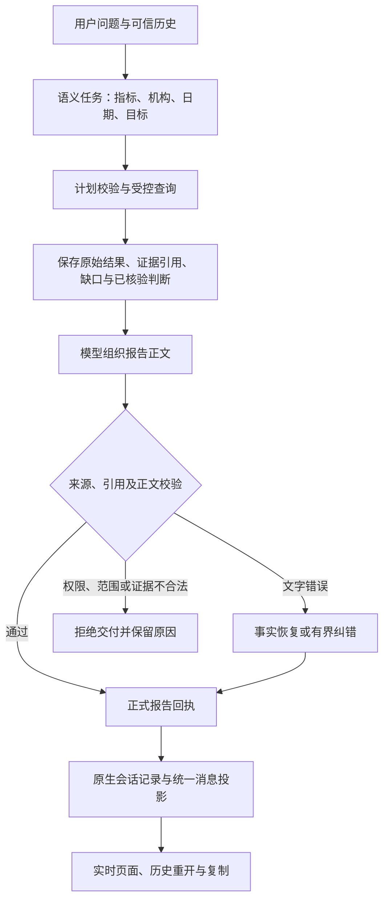

# Ask Metric 报告链路梳理与统一改动方案

日期：2026-10-25。状态：**设计建议，尚未实施**。本次只读审查代码和已有真实记录，没有修改业务代码、调用模型、执行数据库查询或提交推送。

## 1. 这次要解决什么

让业务人员自然提问后，已经正确查询到的数据能稳定变成有依据、看得懂、可以继续追问的回答。模型把一句解释写错时，不应连带丢掉正确的机构、金额和覆盖说明；同一问题换一种合法指标组合，也不应重新暴露相同故障。

推荐在现有模块中统一“事实如何保留、解释如何校验、失败如何收尾、最终答案如何展示”的规则。保留 Ask Metric 的受控查询、权限和会话机制，借鉴 mfws 对原始结果、有限修复和最终正文一致性的处理。

本期不增加 Agent、知识平台、通用规则引擎、报告队列或数据库表，不迁移任意 SQL/Python 执行能力。模型服务超时继续作为独立问题记录；本方案不能承诺消除供应商响应等待。客户流水接入、完整贡献算法和业务因果推断也不在本期新增能力内。

## 2. 当前完整链路

当前有两条报告入口，最后都交付 `business_report`：

| 路径 | 实际实现 | 关键行为 |
| --- | --- | --- |
| 业务概览 | `agent-service/src/tools/businessReport.ts:445` | Agent 在本地校验和编排概览，首次可恢复正文错误会尝试按已选事实重建。 |
| 通用分析 | `agent-service/src/analysis/tools.ts:189` → `backend-next/src/ask_metric/application/analysis_report.py:184` | 后端重新授权运行回执，校验范围、引用、数字、判断及问题覆盖，然后形成报告。 |
| 部分交付 | `agent-service/src/tools/partialAnalysis.ts:21` | 已取得事实但后续分析失败时，由宿主有界收尾，仍重新校验权限。 |
| 最终消息 | `runtime/delivery.ts:38`、`sessionProjection.ts:124` | 报告工具返回的 `public_answer` 是正式正文；成功后结束，不需要模型再总结一次。 |
| 页面 | `BackendNextChatPanel.vue:402`、`businessReportPresentation.ts:5`、`ChatResultContent.vue:217` | 结构化报告显示 `summary/sections`，复制使用正式答案；实时和历史共用转换入口。 |

底层已经有足够基础：`analysis_execution.py:795` 保存事实、计算、观察、缺口及查询结果；`:877` 记录原始子问题的完成情况；`verified_findings.py:195` 依据正式比较信息生成可引用判断。无需另造一套证据系统。

## 3. 同类问题归并

“真实记录确认”表示已有实际会话证据；“源码确认”表示分支条件已核实，本次未重新做页面或模型复现。

| 类别 | 现象与证据 | 共同原因 | 统一处理方向 |
| --- | --- | --- | --- |
| 合法组合不稳定 | 单比较、多比较、余额＋比较先后触发恢复边界。余额＋较上月失败已有真实记录。 | `analysis_report_view.py:137–220` 要求整份报告符合比较模板；任一指标不是比较量，整份恢复返回空。 | 按可信证据组处理，余额和比较各司其职。 |
| 解释错误带走正确事实 | 实测第二问缺少最主要负向机构、正向机构和覆盖说明，只剩“其余”机构。 | `analysis_report.py:678–726` 按自然段裁剪；失败段有多个事实时无法按“唯一事实”恢复，有幸存段落又不补事实摘要。概览部分交付存在同类分支。 | 从结构化证据恢复必要内容，不以幸存段落作为已完整回答的依据。 |
| 重复纠错增加耗时 | 同一真实样本两次报告正文完全相同；额外模型及报告调用合计约 8.07 秒。 | `analysis/tools.ts:245–255` 首次恢复未声明成功时把错误再次交给模型；表达密度审查还拥有单独的改写机会。 | 可确定恢复的正文首次直接收尾；复用已有重复调用检测及预算，风格不单独触发反复重写。 |
| 比较身份口径不一致 | 源码确认存在两套识别方法。 | `verified_findings.py:195–225` 使用正式元数据；`analysis_report_claims.py:40–47` 对事实主要依赖指标名称后缀。 | 复用同一正式比较身份，不用正余额推断增长。 |
| 恢复分支校验不一致 | 普通 fallback 会跳过全局引用预校验，再逐段捕获错误。 | `analysis_report.py:654` 将预校验与恢复模式绑定。 | 所有入口先做来源、引用等硬校验，错误不能通过删段被洗成成功。 |
| 部分完成说明不清楚 | 缺数据、未完成目标和文字被裁剪都可能呈现为 partial。 | 当前 `partial_analysis` 同时承载多个原因；有些原因只进入 `gaps`。 | 保留兼容字段，但根据真实原因给出准确且可见的说明。 |
| 页面与正式正文不同 | 源码确认页面不独立显示 `gaps/source_notices/limitations`；部分交付的未完成提示可能只在 `gaps`。 | 多处组装正文；页面依赖“必要限制已在正文”，生成端未完全满足该约定。 | 最终正文包含必要缺口一次；页面、复制和历史不丢失这些信息。 |
| 明细超过 100 行消失 | 已有真实回执包含 106 行及 `tasks[]`，没有单一 `task_id`；前端仅展示 ≤100 行，>100 行下载又要求单一 task_id。 | 聚合报告套用了普通单任务查询的展示条件。 | 对已随报告完整返回的 rows 复用现有分页表格；不新建导出服务。页面表现待桌面回放确认。 |

最具代表性的失败会话是 `01a171c7-c3cf-71ff-81db-278e0c803571`：第二问查询结果包含余额与较上月，共 106 行；第一次报告因方向断言失败，第二次提交相同正文后采用裁剪，`narrative_repaired:false`。完整数据尚在，回答却丢失主要内容。这是报告交付问题，不能归因于数据库没有返回数据。

## 4. mfws 哪些处理值得结合

只读参考 `jjccb-release@846a49b03555a8f647f93d96684363892e8cef06`，不切换其工作区。

| mfws 实际机制 | 对 Ask 的具体借鉴 | 边界 |
| --- | --- | --- |
| `tools/python_executor.py:318–423` 分开保存查询返回结果和给模型的有限文本，并保留截断标记。 | 原始 rows、证据和覆盖不受报告删改影响；正文可精简，明细仍可访问。 | 所保存的是实际查询返回结果，并非数据库全量；不迁移执行器。 |
| `answer_amounts.py:86–116,256–283` 在唯一、完整、单位明确的来源上做局部 Decimal 修正。 | 先确认事实种类和适用范围，再做确定性恢复；不凭错误文字反推业务事实。 | 这是有限合计校正，不是通用报告验证器，不照搬它的求和规则。 |
| `chat_server.py:3824–3849,4054–4066,4116–4149` 将校正后正文用于 checkpoint、保存和最终输出。 | 页面、历史及后续上下文以同一正式报告终态为准。 | mfws 不是跨存储原子事务，不能宣称它已解决全部一致性问题。 |
| `reporting/agent_adapter.py:302–328,740–751` 仅在空正文且已有工具结果时补一次无工具生成。 | 取数完成后有界收尾，避免无限回到查询或改写。 | 它解决空报告，不解决方向断言；Ask 已有本地事实恢复，不新增这次模型调用。 |
| `skills/attribution-analysis/SKILL.md:10–26` 约束历史口径、完整分组、NULL/零和归因边界。 | 把本期相关约束落实为代码与验收：比较、贡献、业务原因分开。 | 此处主要是技能要求，不能当成 mfws 已实现的运行时强制校验。 |

融合的衡量标准是上述机制是否改善实际交付，不是复制文件或提示词的数量。

## 5. 推荐的统一规则

### 5.1 先检查能否使用这些证据

正常报告、事实恢复、部分交付都先检查：当前权限、会话和任务归属、已确认机构与日期、正式指标身份、引用存在及依赖完整性、同身份事实是否冲突。

未知引用、越权、范围漂移、冲突事实不能归为“文字写错”。这些错误必须拒绝相应报告，不能舍弃问题部分后宣称恢复成功。允许不同组独立展示的前提，是整份选中来源已通过这些校验。

硬错误拒绝的是该份请求，允许在既有预算内提交真正修正的请求，并重新通过全部校验。在当前回合、同一报告目标仍存在未解决的硬错误时，宿主不得丢弃原错误请求后改走 `analysis_partial_present`，把它转成成功；后续合法请求完整通过校验后才可继续交付。判断复用已有工具回执和执行归属，不新建跨轮错误状态。

本轮新取数必须保留原始目标及子问题；历史解释可以按已验证的 focus 缩小范围。一个指标确实缺数可以作为明确缺口交付，但不能靠删除这个指标改变用户要求。

### 5.2 按证据种类恢复，不按某句话或指标数量打补丁

在现有 `analysis_report_view.py` 中组织证据，保留来源及子问题归属；以正式指标身份、实际日期、比较基期、单位和机构范围区分组。不同来源在未经确认可合并时分别呈现；重复的同一原子只展示一次，冲突不能任选一条。

| 已有证据 | 允许形成的正文 | 不允许附加的解释 |
| --- | --- | --- |
| 余额、数量等直接事实 | 中性呈现已查值，保留指标、机构、日期、单位。 | 不能因余额为正就说增长，不能因余额小就说拖累。 |
| 正式差额或增幅 | 在同指标、日期、基期和单位下比较，按 Decimal 原值排序；保留正、负、零及实际覆盖。 | 不跨基期相加，不把差额排名叫完整贡献率，不把“部分下降”写成“全面下降”。 |
| 已存在的受控计算、`verified_findings` | 使用已有结果与完整 input_refs，保留其结论范围。 | 不在报告层新增计算公式或从显示值反算。 |
| 缺数、目录缺口、未完成步骤 | 说明检查过什么、缺什么、哪些结论尚不能给出。 | 不把 NULL/缺数当零，不把当前日期无数替换成其他日期。 |
| 无正式语义支持的值 | 如果身份、单位等足以准确展示，只展示原值并说明解释限制。 | 不猜比较基期、因果或机构可加总关系。 |

余额＋较上月应同时保留余额事实和较上月的机构比较。一个指标没有数据，不妨碍其他已授权有效指标展示，但缺失指标仍属于未完成部分。多日期分别标注；多子问题分别给结果或缺口。适用不了某种分析判断，不等于它的原始事实必须消失。

正文仍以用户当前关注内容为先，完整明细放在原有展开区域。涉及机构变动时，优先保留主要负向机构、正向反例和覆盖说明；既有负向前 10、正向前 4 的摘要上限可继续使用，但不是新计算出来的贡献排名。明确排序需求优先遵从已校验计划，不能用固定摘要顺序覆盖用户要求。

### 5.3 允许模型组织表达，但不让文字错误控制事实去留

1. 正常正文通过校验则保留，不把所有回答强制改成固定模板。
2. 正文存在可恢复的数值、方向或原因断言错误时，使用已选证据生成必要正文，再通过同一校验器。不得根据错误段落猜测事实身份。
3. 恢复必须回应当前目标：有结果的组可见，没结果的组有具体缺口；不能因为某段“其他机构”通过就宣布回答完成。
4. 恢复成功后当次报告工具直接结束，不新增 SQL，不让模型再复述一遍。
5. 不支持本地完整恢复的表达，最多保留一次已有模型修正机会；之后交付经重新校验的有限事实与具体未完成项。连已查范围和缺口都无法证实则如实失败，不返回空成功；尚未解决的硬错误仍按 5.1 处理。
6. 复用 `toolRecovery.ts:49–97` 的规范化参数指纹和既有运行预算。相同正文只换 JSON 键顺序不算进展；不新建缓存或重试状态机。可用正文的风格/密度不再单独增加模型改写轮次。

两条报告入口遵守同一规则，保留各自当前实现位置。确定性恢复的适用范围扩大后，应替换对应旧分支及测试预期，避免再叠一层“余额＋比较专用补丁”。

### 5.4 分清三种交付结果

| 实际情况 | 给用户的结果 | 现有字段的含义 |
| --- | --- | --- |
| 数据、目标齐全，只是原文字错误且已完整恢复 | 正常给出事实与有依据判断。 | 可记 `narrative_repaired:true`；不因修过文字就标业务不完整。 |
| 有真实缺数或某个分析目标未完成 | 给已有结果，明确具体缺口和不能得出的结论。 | `partial_analysis:true`，依据 dispositions/coverage/gaps 判断，而非凭“是否走了 fallback”。 |
| 权限、来源或证据完整性不能确认 | 不交付未经授权或不可信的数值报告，保留可诊断错误。 | 失败，不能伪装成部分成功。 |

全部指标无有效值时，若已授权回执能证明正确范围已检查及实际缺口，可以 `succeeded + partial_analysis:true` 交付缺口说明，不生成排名或数值。这表示说明交付成功，不能表述为已完成用户要求的数值分析。若查询完成状态或缺口来源也不能证明，则失败。

保留现有响应字段，不新增持久化状态体系。修复日志用于开发诊断；用户看到的是结果和实际限制，不是内部工具参数或模型纠错过程。

### 5.5 最终正文、页面与历史一致

生成端从同一份已校验 summary/sections 编排正式答案；当前结果必需的缺数、未完成原因和归因边界必须进入可见正文一次。来源元信息可以保持现有轻量展示，不另加卡片或重排页面。

`partialAnalysis.ts` 的“完整分析尚未完成”原因必须同时进入最终正文与报告视图，不能只放在页面不显示的 `gaps`。复制允许包含额外来源信息，但不能与页面在结论、范围或完成状态上冲突。

实时收尾、刷新、重连、历史重开继续复用现有正式回执投影。中间模型错误若已恢复可以不显示为最终失败，但原始记录仍保留；真正失败、取消及未交付不得标为成功。

聚合报告已经携带完整 rows 时，复用当前分页表格，覆盖 53 行及 106 行等边界；普通查询现有单 task_id 下载路径不变。不得伪造聚合 task_id、只取第一项任务或新增取数。若回执本身不完整，明确只显示已返回部分，不能声称已展示全部明细。

## 6. 预计涉及哪些代码

以下是建议修改范围，实施前按当时 diff 再核对。现有未提交改动不是这次已完成的新成果。

| 文件/模块 | 建议职责与改动 |
| --- | --- |
| `backend-next/src/ask_metric/application/analysis_report_view.py` | 将整份比较模板限制收敛为按可信证据组恢复；余额、比较、既有计算、缺口分别呈现。 |
| `backend-next/src/ask_metric/application/analysis_report.py` | 所有路径先执行硬校验；恢复后核对问题覆盖；统一生成必要正文、缺口及 partial 标记，替代连带丢事实的裁段策略。 |
| `backend-next/src/ask_metric/application/analysis_report_claims.py`、`verified_findings.py` | 复用正式比较身份识别。仅提取必要的共享判定，不重写已有判断算法；旧回执缺少元数据时保守处理，不补猜。 |
| `agent-service/src/analysis/tools.ts`、`analysis/narrative.ts` | 对齐恢复回执和有界纠错；完整恢复当次交付；风格提示不另加报告往返。 |
| `agent-service/src/tools/businessReport.ts` | 概览正常/部分报告采用同一事实保留原则，保留现有授权和所选指标限制。 |
| `agent-service/src/tools/partialAnalysis.ts` | 真实未完成原因进入可见正文；仍按原任务范围重新授权，不重复输出无关历史报告。 |
| `agent-service/src/harnessHost.ts` 的部分交付入口 | 对当前回合尚未解决的报告硬错误保留拒绝语义，不能绕过失败请求自动转部分成功；复用现有工具回执及归属判断。 |
| `frontend-vue/src/components/chat/BackendNextChatPanel.vue` | 修正聚合报告已有 rows 的 100 行展示边界，复用分页表格。 |
| `frontend-vue/src/lib/businessReportPresentation.ts`、`ChatResultContent.vue` | 优先增加契约验证；只有生成端统一后仍存在消费缺口才作局部适配，不重做 UI。 |

`answerEvidence.ts`、`runtime/control.ts`、`sessionProjection.ts`、`toolRecovery.ts` 以复用和回归为主，不计划重写；宿主保护仅限上述报告硬错误收尾路径。后端查询执行、数据库、模型配置、超时阈值、登录与部署脚本不在本期改动范围。

## 7. 验收场景：覆盖一类问题，而非只背三句话

以下均为**预期标准，不是本次执行结果**。先用固定回执验证确定性规则，再用现有真实模型和 `3309/ads_lake` 验证自然问法。

### 7.1 固定证据与失败路径

| ID | 输入场景 | 必须满足 |
| --- | --- | --- |
| R01 | 原单比较指标回执，正文混入无依据整体判断 | 保留主要负向、正向和覆盖；一次报告调用完成本地恢复，无额外 SQL/模型改写。 |
| R02 | 两个比较基期、方向可能相反 | 各自排序、覆盖和日期准确，不混加；两个指标的必要事实都保留。 |
| R03 | 真实余额＋较上月回执、原失败正文 | 余额中性展示；较上月回答机构变动；最大负向机构、正向反例和实际缺口不丢。 |
| R04 | 两个普通余额指标 | 均可展示；不创造趋势、增速或拖累判断。 |
| R05 | 同段多个真实事实＋错误原因/方向；另外有一段合法文字 | 坏解释被替代；合法段的存在不阻止必要事实恢复；标题也不能保留无依据结论。 |
| R06 | 部分缺数、一个指标全缺、所有指标全缺 | 分别报告真实覆盖；零值不等于缺数；已证实全缺可交付缺口且标 partial，不造排名或“持平”；连缺口都不能证实则失败。 |
| R07 | 合法多子问题、补查、多实际日期 | 保留每个原始子问题的结果或缺口；日期分别说明；不能只呈现最后补查。 |
| R08 | 未知引用、错机构/日期、撤权、依赖缺失/循环、同身份冲突 | 正常与 fallback 均拒绝相应报告；不能用另一合法组掩盖错误。继续走到宿主预算收尾也不能变成部分成功；真正修正并重新通过全部校验的请求可正常交付。 |
| R09 | 原样重交错误正文、只改 JSON 键顺序、已合法但较长的正文 | 不形成无进展循环；无密度导致的独立改写；次数受现有预算限制。 |
| R10 | 金额、比例、百分点、正负与零、同值歧义、高精度值 | 保留单位和精度；排序使用原值；不得反转方向、扩大比较或把余额当变化。 |
| R11 | 机构有负向变动，但没有完整贡献或客户资金证据 | 给机构变化及证据边界；不写全行贡献率、客户名单或资金转移原因。 |
| R12 | 本轮新分析、同轮恢复、纯历史解释、客户能力不足 | 当前待交付才要求报告；纯历史解释不重复旧报告；客户追问正常终止并说明能力限制。 |
| R13 | 正常、修复、数据缺失、模型/补查失败的部分报告 | 页面、复制、实时收尾、刷新及历史中的关键事实与完成状态一致；限制至少出现一次且不重复堆砌。 |
| R14 | 53 行与真实 106 行报告；只有 tasks[]，没有 task_id | 已返回明细均有可用入口，分页可看全；不伪造单任务下载。旧普通查询保持原行为。 |
| R15 | 模型文本被截短、数据本身不完整、终态失败及取消 | 文本摘要不改变原始事实完整性；数据缺口如实保留；失败/取消不得被成功投影覆盖。 |

规则负例可以在隔离测试中对真实回执副本做引用、权限或数值冲突变更，用来证明拒绝行为；这些副本不是实际业务事实，不得写回业务库或当成真实验收。源码硬边界与现有相关单元测试复用，不为每个表格单元增加一套重复测试。

### 7.2 真实业务问法与连续追问

每组使用新会话；同一组内连续追问，不人为补填本来应该继承的条件。

| 组 | 原话 | 验收关注点 |
| --- | --- | --- |
| A：既有主流程 | ①我们行存款怎么少了？ ②能看出是哪些机构拖下来的吗？ ③具体是哪几个客户把钱转走了，给我看看。 | 实际比较若不下降，应纠正问题前提；第二问沿用已确认条件；第三问无数据能力时明确边界，不重复机构报告。 |
| B：混合信息 | ①帮我看看各家现在有多少存款，跟上个月比怎么样。 ②少得最多的是哪几家？有没有往上走的？ | 余额和比较分别呈现；保留正反例；不得只剩“其他机构”。没有默认合理上下文时仍按既有澄清规则处理。 |
| C：基期变化 | ①存款跟上个月、年初比，各家分别怎么样？ ②先只看跟上个月比的，年初那部分不用再说。 | 两个基期不混淆；第二轮只聚焦所选结果，不重复无关内容或扩大查询。 |
| D：解释边界 | ①是不是每家都在降？ ②这就说明客户把钱转走了吗？ | 使用真实正负零和覆盖判断；区分机构变化与客户资金流向，不顺着错误前提编解释。D 从 A 或 B 的已有报告继续。 |

另用现有两比较指标 106 行回执做桌面回放，检查明细、复制、刷新与重连。真实模型不一定每次选到同一组合，因此用真实问法检验语义路径，用固定回执检验报告组合，二者不能互相冒充。

实施后记录实际选中的指标、机构、日期、证据组合、报告次数、恢复原因、SQL 次数及耗时；不只看回答“是否有文字”。真实源值按实际运行结果核对，不把本次的 60/53/7 写成永久规则。

## 8. 实施顺序与停止标准

本节是建议顺序，当前不开始实施。每步完成相关验证后进入下一步，不继续追加无关优化。

1. **固定报告失败样本和契约。** 保留原始回执/正文；在现有 `test_analysis_report_recovery.py`、`test_analysis_report_claims.py`、`analysisReportRepair.test.ts`、`businessReportRepair.test.ts` 中建立能暴露 R01–R10 的最小回归。将原来“余额组合一律拒绝恢复”的测试拆成合法组合与真正冲突两类。
2. **统一后端事实恢复与交付覆盖。** 先处理硬校验及比较身份，再实现分组恢复和目标覆盖；验证余额、多比较、缺数、多日期及多子问题。恢复不生成新的计算或查询。
3. **对齐两个入口、部分交付与页面消费。** 复用已有预算与重复检测，统一必要正文；修正已有 rows 的明细入口。补最小前端契约测试与桌面核对，不重构整个聊天面板。
4. **跑真实场景并交付。** 运行 A/B/C 及解释追问，记录全部成功与失败；核对源值、关键事实、真实缺口和无进展调用。若再次发现同类问题，应回到规则和回归补齐，不针对某句中文新增分支。

建议验证命令使用现有脚本：

- 后端：在 `backend-next` 执行 `.venv/bin/python -m pytest verification/test_analysis_report_recovery.py verification/test_analysis_report_claims.py`，再按具体改动补充现有判断/执行相关用例；对变更 Python 文件运行项目 Ruff。
- Agent：先运行上述相关报告、历史交付、部分交付和恢复测试，再运行 `npm run typecheck`、`npm run build`；因触及共同交付路径，在交付前跑现有 Agent 测试集一次。
- 前端：只在对应消费改动后运行相关契约测试、`npm run typecheck`、`npm run build`，再做桌面操作验证。当前配置支持 `specs/**/*.ts`，本次未找到已有报告契约测试，应补最小测试，不宣称已有覆盖。
- 最后检查本次 diff 和 `git diff --check`；不因此跑全平台验收、部署或扩大数据库检查。

完成标准：已覆盖的事实种类在合法组合下稳定交付；核心事实不因错误解释丢失；所有关键缺口可见；硬错误不被恢复掩盖；R01–R03 的确定性恢复没有额外模型改写；页面及历史结果一致，106 行明细可查看；真实场景失败项全部列明。

“报告按约定正确说明缺数”可以验收通过，但不能宣称已经补齐数据或完成客户归因。模型超时若阻断真实流程，应记为本次端到端验收受阻，不能用离线回放代替通过；也不为追求速度放宽证据校验。

## 9. 方案取舍

| 选择 | 代价与结果 | 建议 |
| --- | --- | --- |
| 只增加余额＋比较特例 | 当下改动最小，但多日期、多子问题等组合仍容易重复暴露裁段问题。 | 不采用。 |
| 在现有报告模块统一证据分组、恢复与终态展示约定 | 修改范围跨后端、Agent 和局部前端，但直接对应已发现问题；保留正常模型表达。 | **推荐。** 按上面四步验证和交付。 |
| 合并两个报告系统，迁移 mfws 长报告框架 | 接口、会话、部署和回归成本明显增加，当前问题不需要这些能力。 | 本期不做。 |

代价是错误正文被恢复后，部分表达会比自由生成更规整；换来的是可核对的事实和稳定的范围。正常通过的模型表达继续保留。自然语言校验仍有边界，本期不声称证明所有任意中文推论，只保证明确列出的证据与交付契约。

## 10. 本次依据与验证边界

- Ask 基线：`develop@d9e24b3` 加当前未提交改动；本方案针对实际工作区，并非仅审查已提交版本。
- mfws：已提交的 `jjccb-release@846a49b`；参考实现与提示词要求已分开列明。
- 历史实际记录见 [业务自然问法新旧对比](../../业务自然问法新旧对比-2026-10-24.md) 的“前两问报告纠错”“第二问模型等待”“模型首响应超时”三节。
- 本地原始证据：`.runtime/local/response-latency-20261025/`（两比较指标失败）、`.runtime/local/model-transport-repeat-20261025/`（余额＋比较、重复正文、106 行）、`.runtime/local/model-transport-final-20261025/`（实际模型等待与最终三轮）。路径相对仓库；证据不随本方案复制到文档或提交。
- 本次完成代码链路、已有回执和方案内容核对；页面新增发现尚未实际复现，方案效果尚未通过新一轮模型验收。引用行号为审查时位置，后续改动可能移动。

实施与提交授权分开。本次交付仅为设计，保留全部已有工作区改动，不自动提交、推送或部署。
