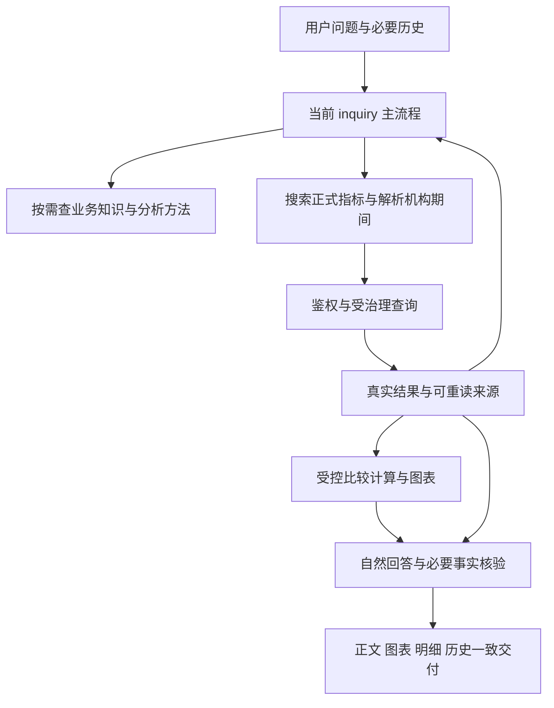

# Ask Metric 智能问数平台能力评估

评估日期：2026-10-27。对象：面向行内业务人员的指标查询、连续追问、经营分析及有证据的归因。

具体盘点请先读[菜单、页面与按钮清单](../../平台功能清单-菜单与操作-2026-10-27.md)和[问数数据准备清单](../../问数数据准备清单-2026-10-27.md)：前者区分界面、接线和待补操作，后者按业务问题列出所需数据、提供方及验收条件。本文保留平台全景和代码评估依据。

## 1. 结论与证据边界

当前工程已具备可继续建设的指标问数产品和执行基础，但平台建设的缺口明显。第一版评估主要检查了问数链路，遗漏了数据资产管理、指标生命周期、分析资产、反馈运营、模型配置生效范围等内容，不能作为完整平台建设清单。本轮补齐这些领域，保留后文的链路专项分析。

成熟度目标应同时覆盖业务使用、数据管理、内容维护、质量运营和运行保障。可以继续利用现有架构；是否需要扩大数据模型和持久化能力，应由明确的平台范围决定，不能把“不过度设计”理解成只修聊天问题。

目前不能宣布“成熟银行项目已完成”：最新代码的真实业务效果、长链调查的可交付性、跨机构贡献、异常体验和目标环境运行指标仍有缺口。知识图谱、更多菜单和更多提示词都不是当前最先要补的部分。

### 本次核对基线

- Ask Metric：`develop-ws`，HEAD `0d86941d53e7534424b883b85b7b623bfc29d54f`。
- 工作区另有 AGENTS、业务知识、模型配置、既有融合待办的未提交修改及历史未跟踪文档；本次读取当前内容，未修改这些文件。
- MFWS：只读参考 `text-to-sql-agent-release` 仓库中已提交的 `jjccb-release@846a49b03555a8f647f93d96684363892e8cef06`，没有切换其工作区。
- 方法：源码与接口追踪、测试用例阅读、已有验收和部署记录核对。没有重新运行应用测试、调用模型、查询业务库、登录页面或实施部署。
- 既有待办记载该提交曾通过 Agent 921 项、后端相关 367 项检查；这是已有记录，不是本次重新验证，也不是当前版本真实业务效果达标的证据。

状态分为：**已有实现**、**有限/未闭环**、**仓库内未发现**、**待业务确认/实测**。未发现代码不代表行内其他系统没有该能力；有页面、表结构或接口也不等于执行链已经使用。不使用缺乏口径的完成百分比。

本次文档回应用户重新评估和制定计划的要求。原[融合待办](../../Ask-Metric融合待办清单-2026-10-26.md)继续作为实施进度入口；本评估不自动重新激活历史计划中的未勾选任务，也不覆盖原台账。后续采纳的工作包再归并到原台账。

## 2. 完整平台应覆盖什么

### 2.1 平台角色与服务范围

建议以一个银行内多个机构、多个已批准业务主题为目标，先完成一个主题的完整使用和管理流程，再扩展。多银行租户、任意跨库查询不默认纳入首期。这是本次规划建议，尚非已确定的产品边界。

需要覆盖五类使用者的工作：业务人员提问和使用结果；指标/数据负责人维护口径和可用性；业务专家维护知识和分析方法；运营人员处理反馈并复测；管理员/运维管理权限、配置、运行和发布。角色可由现有人员兼任，不等于新增五套账号体系。

### 2.2 平台能力矩阵

表中“应补”是目标能力，实施时可由 Ask Metric 自建、现有能力扩展或接入行内系统完成，不意味着全部新增菜单。

| 领域 | 当前代码实际具备 | 未完成的平台能力 | 建设取舍 |
| --- | --- | --- | --- |
| 数据源接入 | 配置型连接；目录库与查询库可分离；MySQL/GoldenDB、Inceptor 适配；池、超时和连通检查 | 数据源资产、责任人、可用状态、变更与凭据生命周期未形成管理流程 | 首先登记当前源和连接状态；凭据托管优先接行内服务，不做 ETL 平台 |
| 元数据与可执行数据集 | Dataset CRUD 和字段模型声明；全局事实表/字段映射 | 数据集登记未接入运行时选源、字段映射与启停；未形成多个语义数据集的查询路由 | 先明确配置唯一来源并接通现有数据集；再以第二个真实数据集验收扩展能力 |
| 指标资产治理 | 编码、名称、单位、说明、口径、同义词、启停；源目录同步 CLI 和 dry-run | 责任人、发布快照、生效版本、退役和本地覆盖策略不足；修改直接覆盖当前目录 | 对接正式指标平台，保留本地语义补充；不在问数平台重做指标生产 |
| 数据质量、时效与血缘 | 按需覆盖、最新日、部分滞后信息、无效值/重复事实检查；部分源编码与批次选择 | 持续新鲜度目标、质量状态、问题责任和完整来源批次追溯未闭环 | 消费上游质量与血缘；本地补查询必须的检查，不能把“有日期”当作数据完整 |
| 业务知识与分析方法 | 知识 CRUD、启停、检索、冲突保护；方法技能 | 来源透传、责任/适用范围、业务版本与使用效果不足；无完整文档导入流程 | 先维护本行事实和方法；按真实资料类型决定导入和审核，不堆通用常识 |
| 语义理解与连续问数 | 目录检索、多轮引用、历史重读、默认范围和受治理执行 | 最新版本缺统一真实验收；容量、任务切换、期间和交付风险需收敛 | 沿用 W0–W2，以问题类别和实际条件验证，不追加句式规则 |
| 多维分析与归因 | 指标×机构×时间的比较、趋势、排名、部分结构；两事实计算 | 未接通完整关系发现与贡献；不具备任意客户/产品/渠道钻取、因果和预测 | 先批准关系、接通受控计算；新业务维度必须有数据模型和权限依据 |
| 图表、导出与分析资产 | 聊天内报告/图表、结果明细和部分 Excel 导出 | 普通结果导出体验不统一；缺独立保存分析、资产检索、可授权分享 | 先完整交付和保存可复用结果；共享须重新鉴权，不直接公开会话链接 |
| 工作台与会话管理 | 示例问题、会话列表、继续追问、删除；本地标题覆盖 | 示例日期固定；无服务端改名/历史搜索/收藏管理等完整能力 | 优先可用示例、历史查找和服务端一致性；不为工作台增加装饰性大屏 |
| 报告、看板与订阅 | 聊天内经营分析输出 | 未发现独立报告任务、模板管理、Word/PDF 报告交付、看板编排、定时订阅与阈值预警 | 报告是明确业务产出时优先参考 MFWS；看板/订阅先确认现有 BI 能否承担 |
| 身份、数据安全与审计 | SSO、本地账号状态/会话撤销、机构同步、机构授权、结果归属和导出再鉴权；执行日志与工具审计 | 新资产授权、管理/导出事件归档未闭环；行列分类、模型可接收数据范围、保留规则需确认 | 复用 IAM/审计；按真实数据分类执行权限和必要脱敏，检索/历史/导出一致，不预建多租户权限平台 |
| 模型、提示词与工具治理 | 后端模型配置、提示词版本/发布/回滚、Nacos 适配；固定工具集 | 后端管理页面不等于当前 inquiry 全部生效；Agent 主提示词在源码，配置启动读取；缺整体效果版本关联 | 明确每项配置归谁、影响哪条链、何时生效；工具继续代码治理，暂不做任意插件市场 |
| 反馈与运营处理 | 查询日志、失败诊断 | 未发现业务用户纠错、处理状态、责任人、复测、反馈转案例的完整流程 | 优先借鉴 MFWS 反馈处理；一个轻量入口和处理台即可起步 |
| 评测与版本比较 | 大量测试、语料和审计脚本；人工新老版本题单 | 缺统一真实样例、预期条件/结果、业务评分、版本比较与发布回归入口 | 先复用脚本生成可复核报告；需要多人运营时再建设评测页面 |
| 用量、性能与运行保障 | 工具/模型耗时、查询日志、部分用量记录、超时/取消、部分并发控制 | 跨会话准入、用户配额、成本汇总、持续告警与容量/恢复验收不足 | 先测量并保护资源，聚合现有记录；成本按实际服务计费，不凭 token 数猜账单 |
| 部署、集成与持续交付 | API、SSO、离线包、健康、升级回退、数据库迁移；本地单写会话 | 当前版本环境验收不足；外部 CI/监控/备份未确认；对接契约、保留/恢复目标需明确 | 接入行内现有发布、审计和运维体系；单写或多实例由约定负载和可用性要求决定 |

### 2.3 本次新增的关键发现

1. **数据集页面与实际查询没有完整接通。** `Dataset/DatasetField` 在 `infrastructure/db/models.py:181` 定义，`api/routes/catalogs.py:482` 提供维护，但查询装配在 `api/dependencies.py:193`、`infrastructure/query/sql_builder.py:1041` 使用全局 Settings。`DatasetsView.vue:110–120` 的“最新配置被问数引用、停用后不参与查询”缺少相应执行依据。应先明确功能边界并修复接线/文案不一致，不能据 CRUD 宣称多数据集能力。
2. **指标源同步和本地维护缺少明确优先级。** `application/catalog_sync.py:185–203` 同步时写入 `enabled=True`，同时注明无法区分源同步与手工维护。可推断手工停用的源指标可能被后续同步重新启用，需复现并确定权威来源、允许覆盖字段及退役规则。
3. **智能配置菜单没有统一覆盖当前主流程。** 后端提示词发布/回滚已经存在，不能再造一套；但 `agent-service/src/inquiry/runtime.ts:102` 定义 inquiry 主提示词，`nacosConfig.ts:19` 的 Agent 配置在启动时读取。必须核对运行时真实生效位置，不能让维护者以为保存页面就更新全部问数行为。
4. **结果还没有形成可运营的业务资产。** 会话可保存不等于报告可管理；日志可查看不等于反馈已处理。当前缺少“用户纠错→责任人处理→复测→案例积累”以及独立报告任务/复用的产品闭环，MFWS 在这两部分有实际代码可参考。
5. **目录来源与查询证据，不等于完整数据血缘。** 当前有源指标编码、口径及运行引用，也有源批次选择；查询输出未完整保留原始 ETL 批次，不能保证多次读取就是同一物理数据快照。首期可记录资产/批次并关联上游血缘，不必自建图谱。
6. **运行管理已有基础，但还没有完整运营依据。** 已有使用量事件、工具审计、日志和部分并发控制；Agent 同会话串行并非跨会话全局配额。模型费用配置为零不代表实际免费，本人查询日志也不是中央审计。平台需要清楚区分查询成功率、业务准确率、用户反馈和实际费用，并约定告警、处置和恢复责任。

### 2.4 谁来建设

- **Ask Metric 应直接承担：** 受治理问数、可执行语义映射、结果证据、分析/图表交付、会话资产、反馈与评测接入、运行状态和本应用授权。
- **优先对接行内现有能力：** SSO/组织身份、正式指标口径及生产、ETL 调度、企业元数据与血缘、质量告警、凭据管理、审计归档、监控发布。能否接入、以 API 还是受控文件交付，需要核实。
- **按真实需求扩展：** 报告模板、看板、分享、订阅、阈值预警、客户明细分析。这些属于平台能力全景，应进入路线图；先选实际业务产出，不把所有功能同时设为第一版门槛。

## 3. 问数专项：目标、边界和当前主链路

目标是让业务人员自然提问后，得到对象、指标、期间正确的回答；连续追问不重复补已确认条件；分析有实际依据；图表、正文和明细一致；缺数和失败有真实、可恢复的反馈。

继续使用 Vue 3、TypeScript、FastAPI、现有数据库、Pi 原生会话和受治理查询/计算接口。不引入新的 Agent 框架、整段自然语言审核系统或知识图谱平台；不把自由 SQL、任意 Python 执行迁入当前问数链路。

普通自然文本在 `harnessHost.ts:1297–1300` 选择 `inquiry_v1`。结构化澄清等入口仍保留兼容流程，不能因为主流程升级就删除旧入口，也不能继续把 README 的旧 Frame 时序当作全部请求的实际执行过程。

## 4. 问数专项：已有能力与实际边界

| 领域 | 已有实现 | 成熟度边界 |
| --- | --- | --- |
| 产品入口 | 登录/SSO、问数、指标、机构、数据集、日志、智能配置、业务知识页面 | 没有独立用户管理页不等于缺少身份管理；先复用行内 SSO 和用户机构同步脚本 |
| 指标问数 | 正式目录检索、引用绑定、机构权限、日期覆盖、确定性 SQL 构建和参数执行 | 模型选择正确、机构范围正确、目录口径齐备仍需真实验收 |
| 上下文 | 最近三轮投影、更早历史分页、结果引用重读及重新鉴权、机构/指标对应日期继承 | 已有实现不等于所有省略追问、话题切换都已通过实测 |
| 分析和计算 | 结果驱动补查、同指标事实差额/支持的增幅、真实来源引用 | 不是完整经营诊断、跨机构贡献或客户资金去向分析 |
| 回答和恢复 | 自然正文、来源/数字/单位核验、有限纠错、部分事实交付 | 引用正确不能证明所有子问题已回答、统计期表述正确或因果成立 |
| 图表和明细 | 柱/折线等图表、部分报告饼图、明细分页、部分大结果导出、历史读取 | 不同入口支持范围不完全相同；不能从前端有饼图组件推断 inquiry 会自动生成饼图 |
| 业务知识 | 标题/正文/启停维护、编辑冲突保护、自动和按需检索 | 当前为轻量词法检索；无逐条可见范围与业务生效版本；来源字段未完整传到模型侧 |
| 运行交付 | 服务端鉴权、审计、工具耗时、模型首响应/空闲超时、离线打包、健康检查、升级回退脚本 | 当前 HEAD 的行内性能、恢复演练和容量尚不能用旧版本记录替代 |

## 5. 问数专项：按优先级收敛的缺口

### P0：现有链路的正确性与可交付性

**G1. 调查容量与报告来源容量不一致——确定代码事实。**

`inquiry/runtime.ts:9` 允许 16 次调查回执；`inquiry/reportTool.ts:80–87` 和后端 `AnalysisReportRequest.run_refs` 最多接收 6 个真实运行，且不能静默删除本轮已查询目标。`tests/inquiryReport.test.ts:119` 明确断言 7 个本轮运行被拒绝。复杂分批调查可以先取得结果，后进入无法正常交付的状态。

应在取数前统一容量约束和收尾策略，优先合并独立查询、复用已有结果；不能只放大常量，也不能丢掉来源伪装完成。超出本轮可承载范围时，明确保留哪些已完成、哪些未完成。

**G2. 最新代码缺一组可重复的业务验收基线——验收缺口。**

已有九题、多轮问法、源库核对和截图记录，但分散在 `.runtime/local`，部分脚本依赖更早的本机目录；旧九题结果不能验证之后的 inquiry 重构。需要固定源码、模型配置指纹、目录/知识版本、实际数据期、问题和会话关系，保留“原目标→实际条件→来源→回答→耗时”的对照。

**G3. 校验职责仍需用成对用例收敛——待复现风险。**

当前量值扫描仍处理“数字+家/户/倍/%”；已有“前3名”的放行检查不足以证明“前3家”这类筛选说明不会误伤。另一方面，真实数字引用正确也不能保证“8月27日”没有被叙述成“月末”，或一个多方面问题没有漏答。

先复现应放行的筛选/解释与应拒绝的伪造量值；只修改首次偏离的职责层。不得继续添加“家/名”、机构或原句白名单，不增加通用语义审核器，不声称格式检查已解决全部经营判断。

### P1：可解释分析与业务使用体验

**G4. 指标语义和正式关系尚未准备完整——配置与能力缺口。**

`analysis-semantics.json` 当前 `metrics={}`、`relations=[]`；不表示指标目录没有任何口径，而是该扩展层没有登记关系。`business-topics.json` 有试点关系且注明需业务确认，不能当作已经审核、所有入口都可执行的关系。

需要先确认主要指标的原始单位、比例编码、时点/累计、频率与可比基期，再确认哪些分项互斥、完整、可加总。已有 `structure` 侧重同机构同日的指标分项占比；它不是跨机构两期变化贡献。跨机构贡献必须另核准汇总集合并补最小受控计算。客户流失、资金转出等业务原因仍需相应明细来源。

当前指标检索描述主要发布 observe/compare/trend/ranking，未向 inquiry 完整暴露已审核关系 ID。因此工作范围还必须包括“关系如何被发现并传给执行器”，不能只填 JSON 就宣布归因接通。频率、数量性质等扩展语义也应以业务批准的配置为准，不从“当日数”三个字猜累计含义。

**G5. 前端失败状态和角色体验不够一致——静态风险，待桌面复现。**

- 指标/机构/数据集写按钮没有与管理员权限一致收敛；后端限制写权限。这是界面体验缺口，不能据此称为已发生越权。
- 历史结果快照读取失败保留正文，但缺少明确失败状态和局部重试；可能让用户分不清“无明细”与“未加载成功”。
- 刷新恢复的 operation 取消失败时，提示路径与新请求不一致；需验证“已停止”“停止未确认”“连接中断”能否准确区分。
- 执行中过程默认展开，完成后自动收起；已结束步骤按 600ms 逐行呈现，调试入口包含 SQL/原始诊断。按业务受众收敛实际进展与内部信息，不用人为延迟模拟执行。

当前本地正文流式已按用户要求关闭，相关试验实现被撤回。计划不自动重开，不把恢复流式作为成熟度的硬性前提。前端能消费 SSE 不等于当前主流程正在输出正文增量。

**G6. 性能目标与定位依据需要形成闭环——待实测。**

已有工具耗时、首模型输出和正式答案耗时记录；模型有首响应和空闲超时。应区分模型等待、有效生成、工具查询、重试、重复调查和页面显示。没有当前版本测量，不把慢统一归因于网络、模型或某次代码提交，也不承诺固定秒数。

持续有效输出未受首响应/空闲超时限制；是否需要操作总预算，应由实际长请求和目标环境容量决定，保留取消、部分交付和清晰终态。

### P2：知识与行内运行治理

**G7. 知识治理与检索可复核性不足——确定边界。**

当前中文双字片段/英文词项加权检索每批最多 3 条、正文合计 8000 字符；这只是体积限制。JSON 的 revision 是编辑冲突标识，不是业务生效版本。存在管理员维护、登录后检索，但没有逐条权限/生效期过滤。现有 `source/url/date` 没有完整透传到检索上下文。

先整理内容并建立命中验证，保留来源与适用性；单指标正式口径仍在指标目录维护。出现稳定漏召回后，再复用现有 embedding 适配做知识独立索引和候选融合；不要与指标缓存混用，不承诺现场 embedding 已启用。制度版本和权限在进入模型前过滤；所有知识全行公开的试点不必提前建设复杂权限体系。

**G8. 正式运行边界和验收材料需补齐——部署边界，不代表部署功能缺失。**

Agent 的 `nativeSessions.ts` / `server.ts` 明确采用本地 JSONL、单数据根单写实例。不能直接让多个副本共享该目录。知识配置也采用单进程文件写入保护。首期可以明确单写部署并演练备份恢复，不为了“银行级”先迁移全部存储；明确要求多实例时才做对应方案。

离线构建、配置保留、升级回退已有脚本，2026-10-20 现场成功记录属于旧版本。需对最终选定版本执行目标架构安装、会话/权限/配置恢复、取消和重启检查；数据库迁移遵守现有流程。并发规模、响应目标、保留期、恢复目标和模型接入边界由行内负责人确认。

**G9. 文档与验证入口需要归并——维护缺口。**

README 仍主要叙述旧 Frame 链路，与普通 inquiry 的代码入口不一致。三端已有测试和构建命令，但本次未在仓库发现统一 CI 配置；外部流水线是否存在尚未确认。应更新入口说明、复用现有检查并整理可交接的验收入口，不再复制多套临时脚本或新增重复框架。

## 6. MFWS 的吸收方式

| 已提交参考 | 值得保留的做法 | 在 Ask Metric 的取舍 |
| --- | --- | --- |
| `skills/attribution-analysis/SKILL.md` | 同口径两期分项、完整对账、贡献与原因分开 | 用正式关系和受控计算实现，不直接复制自由 SQL/Python 执行 |
| `agent.py:400–464`、`tools/institution_context.py` | 给模型真实机构、业务知识、案例和方法，由问题与结果推进 | 当前已有显式机构与知识入口，重点验证效果，不再造一套意图系统 |
| `tools/domain_knowledge.py:629–793` | 相关资料召回、不同内容分别管理 | 可借鉴按需参考，不照搬全部策略字段或让管理员配置复杂投放机制 |
| `tools/echarts_tool.py` | 图表引用已查结果，无需模型手抄数值 | 复用当前真实引用和图表链路，补场景验收；不迁移整套数据执行沙箱 |
| `reporting/agent_adapter.py:740–751` | 模板报告有工具结果无正文时有限收尾 | 当前已有部分恢复，先验明缺口；MFWS 此处仅是模板报告，不能夸大为全聊天通用兜底 |
| `chat_server.py:2438、2582–2616` | 用户赞踩/原因、管理查询、转案例标记 | 优先补轻量反馈处理，关联真实消息与版本；转案例前人工核对，不能自动把错误答案收为知识 |
| `reporting/routes.py:36–136`、`service.py:88–126`、`worker.py:59` | 我的报告、持久化任务、取消/失败重试、租约执行、Word 导出 | 借鉴任务和产物生命周期，取数仍调用 Ask Metric 的授权证据接口，不搬另一套 Agent |
| `reporting/templates.py:68–123`、`cold_start_routes.py:34–176` | 模板章节/指标绑定；已有报告提取、审阅、发布、回退 | 有实际周期报告需求时，从一个模板做起；报告冷启动是后续能力，不作为普通问数前置 |

## 7. 问数专项阶段与平台计划的关系

下表仅覆盖 W0–W6 问数专项，不再作为完整平台建设顺序。完整路线见配套计划的“平台工作包与阶段”；指标发布、权限、模型生效配置和运营责任应在平台推广前完成相应门槛，不能因下表的专项 P2 排序一直后置。

| 阶段 | 工作包 | 退出条件 |
| --- | --- | --- |
| A：现状基线和交付稳定 | W0 基线；W1 容量；W2 已复现的正确性/校验问题 | 核心业务场景可重复，容量边界不陷入不可交付状态，权限/来源/单位/期间无已知高优先级错误 |
| B：可解释分析与业务体验 | W3 指标关系和受控归因；W4 失败/角色/表达/图表体验 | 批准范围内能对账解释；超范围如实说明；刷新、取消、缺数、图表和明细一致 |
| C：知识治理 | W5 内容、出处、检索及条件性版本权限 | 应命中的关键知识能命中并适用；无权限/失效资料不进入上下文；未改善的复杂检索不合入 |
| D：行内试点与发布 | W6 耗时、容量、恢复和配套部署 | 在约定环境、账号、负载和数据范围内验收；具备可复核版本、恢复及回退记录 |

W3 的业务关系确认、W5 的内容整理可与 A 阶段并行；不能绕过 A 阶段扩大运行时能力。W6 的观测基线从 W0 开始收集，最终发布门槛在 D 阶段完成。

当前问数修复批次不安排知识图谱平台、多 Agent 平台、微调、任意 SQL、客户明细接入、预测、全自动经营建议或独立新用户后台。报告、反馈、数据治理等已在完整平台路线中补充，不再被遗漏在计划之外。

## 8. 尚待输入，但不阻塞当前评估和基线整理

| 输入 | 谁提供 | 影响 |
| --- | --- | --- |
| 核心问数指标的正式单位、累计口径、关系与组织汇总范围 | 业务/数据负责人 | W3 的可执行归因范围；未知项不能编造 |
| 真实模型与数据环境的验收范围、可用期和账号 | 测试负责人 | W0 实测；本轮未新增真实请求 |
| 并发用户、可接受等待、数据/会话保留与恢复目标 | 业务/运维 | W6 的性能和运行门槛；不预设无依据 SLA |
| 知识是否全行公开、制度是否存在生效版本 | 业务/安全负责人 | W5 是否需要逐条权限与时效过滤 |
| 数据源、指标治理、IAM、质量、BI、监控和工单等行内现有平台及接入方式 | 平台/数据/运维负责人 | 决定平台能力由本项目建设还是对接，避免重复建设 |
| 首期主要使用者、需交付的报告/分析资产、第二个真实业务数据集 | 产品/业务负责人 | 决定平台建设顺序和问数范围，避免以菜单数量代替业务价值 |
| 反馈处理、指标与知识发布的责任人 | 业务/运营负责人 | 保证反馈、内容更新和复测有人完成，不能只交付页面 |

## 9. 核对入口

- [普通请求入口与编排](../../../agent-service/src/harnessHost.ts)、[调查预算](../../../agent-service/src/inquiry/runtime.ts)、[回答来源容量](../../../agent-service/src/inquiry/reportTool.ts)。
- [历史投影](../../../agent-service/src/inquiry/history.ts)、[查询与日期继承](../../../agent-service/src/inquiry/queryTools.ts)、[计算工具](../../../agent-service/src/inquiry/calculationTool.ts)。
- [正式语义](../../../backend-next/src/ask_metric/application/metric_semantics.py)、[语义配置](../../../backend-next/config/analysis-semantics.json)、[主题关系](../../../backend-next/config/business-topics.json)、[计算执行](../../../backend-next/src/ask_metric/application/analysis_execution.py)。
- [回答验证](../../../backend-next/src/ask_metric/application/analysis_report.py)、[知识存储检索](../../../backend-next/src/ask_metric/application/business_knowledge.py)、[知识上下文](../../../agent-service/src/businessKnowledgeContext.ts)。
- [聊天恢复与取消](../../../frontend-vue/src/components/chat/BackendNextChatPanel.vue)、[执行信息展示](../../../frontend-vue/src/components/chat/AgentMessageDiagnostics.vue)、[明细和图表](../../../frontend-vue/src/components/chat/ChatResultContent.vue)。
- [原生会话存储](../../../agent-service/src/nativeSessions.ts)、[离线部署](../../../deploy/package/README.md)、[既有行内交接](../../行内UAT部署交接与打包说明.md)。
- [数据与目录模型](../../../backend-next/src/ask_metric/infrastructure/db/models.py)、[目录维护 API](../../../backend-next/src/ask_metric/api/routes/catalogs.py)、[执行装配](../../../backend-next/src/ask_metric/api/dependencies.py)、[目录同步](../../../backend-next/src/ask_metric/application/catalog_sync.py)。
- [导航入口](../../../frontend-vue/src/config/navigation.ts)、[数据集页面](../../../frontend-vue/src/views/DatasetsView.vue)、[智能配置页面](../../../frontend-vue/src/views/LlmView.vue)、[Agent 启动配置](../../../agent-service/src/nacosConfig.ts)。
- [身份同步](../../../backend-next/scripts/sync_bank_identity.py)、[权限与导出](../../../backend-next/src/ask_metric/application/task_service.py)、[提示词发布 API](../../../backend-next/src/ask_metric/api/routes/model_config.py)、[工具审计](../../../agent-service/src/toolAudit.ts)、[模型用量](../../../agent-service/src/modelUsage.ts)。

配套执行顺序、文件范围和验收用例见[分阶段计划](../plans/2026-10-27-intelligent-metric-maturity-plan.md)。

## 10. 外部产品资料用于校准范围

本轮同时核对一手产品资料，用来检查平台视角是否遗漏，不作为采购建议，也不据此承诺本项目能力：

- Snowflake 的评测以已验证问题/查询作为依据，比较执行结果、回归和耗时，并隔离被测样例以避免直接命中影响评价。这里可借鉴“真实依据+版本回归”的方法；Ask Metric 不必改成自由 SQL。[Cortex Analyst evaluations](https://docs.snowflake.com/en/user-guide/snowflake-cortex/cortex-analyst-evaluations)
- Looker 将内容访问、数据访问和功能权限分别考虑。这支持把“能看到分析资产”与“能访问其数据”分开验收。[Conversational Analytics setup](https://docs.cloud.google.com/looker/docs/conversational-analytics-looker-setup)
- Power BI 的内容生命周期覆盖部署后的支持、使用监测和问题处理。这说明反馈、责任人和运营不应从平台计划中省掉。[Support and monitor content](https://learn.microsoft.com/en-us/power-bi/guidance/powerbi-implementation-planning-content-lifecycle-management-support-monitor)

资料核对日期：2026-10-27。仅借鉴以上能力组织方式，不照搬产品功能、价格、版本或技术体系。
