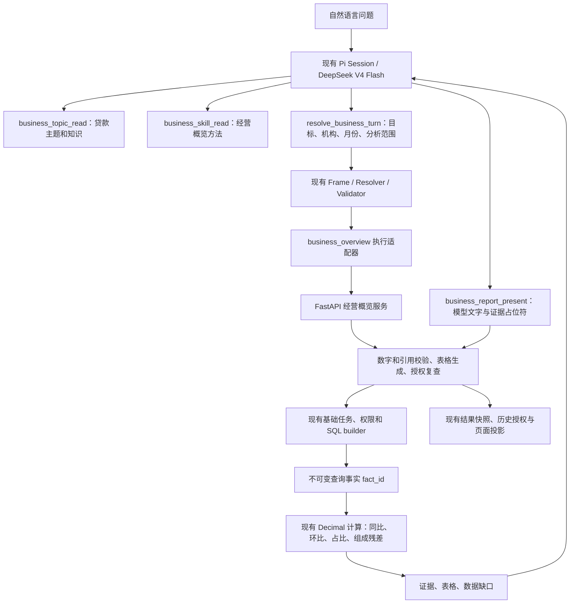

# 贷款经营概览试点

本次把贷款经营分析接入现有 Pi Session、Business Frame、基础查询和 Decimal 计算服务。基础查数仍是共同执行基础，没有另外建立一套分析会话或让模型直接生成 SQL。

当前实现单机构、单日、月份及连续期间的分析：模型理解目标、拆分子问题、选择指标、观察结果后决定补查，并撰写报告；服务端按主题配置执行基础查询、校验计算和组成关系，生成表格并核验文字中的数字。指标绑定、比例存储方式、分类关系和统计口径仍需业务审核，技术验证不能替代这项审核。

“最近／近期／最新贷款情况怎么样”和没有日期的独立问题，服务端在已授权机构内检查所选指标覆盖，选择不晚于查询日的最新记录作为截至日，不默认当前月末，不要求用户提供具体日期。报告展示实际截至日、查询日期及相隔天数，避免把旧记录说成今天的情况。“最近三个月”“今年五月份到十月份”等有界期间保留完整范围，每个月取范围内的最新实际记录；月中记录不冒充月末，有部分数据仍展示结果并披露缺口。单个快照不能证明整个期间的持续趋势，余额不跨日或跨月加总。

## 调用关系

## 知识、主题与 Skill 各放什么

| 位置 | 内容 | 执行作用 |
| --- | --- | --- |
| `backend-next/config/business-topics.json` | 正式指标绑定、复合比较定义、单位与比例编码、分类关系、频率、公式、组成核对容差和版本 | 服务端决定取数与计算规则；不能由模型随意修改 |
| `agent-service/skills/business-overview/SKILL.md` | 识别概览/增长/结构/质量目标、如何选范围、何时默认、如何处理缺口与因果边界 | 供模型按语义规划，不为每种贷款问法建一个 Skill |
| `backend-next/config/business-knowledge.json` | 带来源的分析背景和证据要求 | 规划时可查询；不是本机构数值或实际原因的证据 |

主题中的 `classification` 是分类关系，可能交叉；`reconciliation` 才声明可以核对的组成。农户贷款按主体分类，个人经营性等按用途分类，不能把两组相加。当前只核对“个人 + 对公（剔除贴现）+ 贴现”与各项贷款，分别核对分析月及上月；超过容差时披露残差并停止完整组成归因。

指标通过正式编码或完整名称/别名唯一匹配，同时检查单位和取值口径。历史目录缺少口径元数据时，正式复合指标要求完整名称及编码同时精确匹配。上线时应优先填写本行批准的 `code`。一般性消费贷款与消费贷款不能混为同一指标。比例编码由主题显式声明：`value_encoding=ratio` 表示底层小数比例，按百分制展示；金额亿元展示也由 Decimal 处理，原始事实保留精度，模型不能自行换算。

正式比较同时提供增量和增幅时，按主题公式检查与当前余额的数学一致性，容差用于舍入，不是经营评价阈值。比较分母为零或数值不一致时保留查询记录、暂停该比较分析并披露数据质量缺口；不生成反推基期事实，不用零增长替代未知增幅。

本试点知识使用本地 JSON 条目，没有接入 WeKnora、向量检索或知识管理页面。后续可以替换知识读取实现，保持来源、适用口径、审核状态和证据边界；检索结果不能绕过取数权限或公式约束。

## “本月贷款情况怎么样”的处理

1. 模型识别为贷款概览，参考主题和方法，提交 `goal=overview`、四个分析范围及用户原文条件。
2. 未指定机构时使用认证账户所属机构；明确指定机构则由现有解析器和权限服务校验。未知机构不能静默替换。
   模型漏填机构或误clear时，通过目录名称/别名匹配本轮原文补齐；模型已按原文明确set机构时保留其选择，避免将否定或对比语句里的所有名称误并入查询。
   明确日期由服务端从本轮原文提取完整表达，模型遗漏、改写年份或截取区间端点时以真实原文解析，不因此要求用户重述。用户追问“这个期间”时继承当前日期与机构；旧会话内可以识别但曾解析失败的期间会重新解析。
3. 未指定日期的独立问题选择最新实际记录；“本月”仍是上海时区的本月范围，覆盖检查截止今天，查询范围内的实际记录，不把月中数据冒充月末。
4. 期间缺少某些月份时展示已有月份、逐月标明实际截至日并说明缺口；完全缺数则交付空表格及文字。明确期间不使用范围外月份替代；只有一个快照时不生成全期间增量或连续走势。
5. 规划具体子问题及指标，首轮概览查看总量、三大组成和可用质量指标，覆盖四方面不代表查询全部明细。观察哪项变化值得解释，再依据实际绑定补查相应分项，最多三轮。
   `followup_policy` 根据已校验比较证据和指标树触发必要补查：总量增长而某个分类父指标下降、且存在未查的可用子指标时，宿主要求模型修改计划并取数，报告工具也拒绝跳过。没有绑定、季度日期不符或已尝试但缺数时不盲目扩查；三轮后用已有证据与缺口交付。此规则控制分析动作，不生成预设结论。
6. 每个指标调用现有基础查询任务；比较日期统一，计算只绑定真实 `fact_id`，公式来自主题。原始基期余额缺失时，可直接引用正式绑定的复合比较指标，不能反推出虚构历史余额。
7. 模型根据证据自主选择报告重点和章节，最后调用 `business_report_present`，同时交付基础表格、文字报告和可展开的业务子问题。没有质量数据就说明无法完成质量分析；没有投放、还款、核销和客户证据就不判断实际业务原因。

显式单指标取值继续使用现有基础问数。“贷款结构有什么变化”“信贷业务表现”“贷款为什么增长”可使用同一方法的不同分析范围。针对“为什么”，本阶段回答可验证的分项变化来源，并说明因果证据缺口。

同比与较上月的周期不同，不能通过二者大小比较判断增长加速。单日分析表示截至该日的余额；月中较上月不能称为完整月份环比。当前组成核对通过只证明当前数值关系，缺比较期组成时不能宣称完成精确全量贡献归因。没有审核阈值、同业对照或风险证据时，不评价不良率偏高、偏低或风险可控。

不良余额与不良率的“均改善／均上升”等复合判断，需要在所述比较期间分别具有方向一致的正式增量证据；报告校验发现相反方向或缺比较证据时要求模型纠正，不能将余额与比例混为一个趋势。
正式分项增量可用时，回执提供按比较期间分别排序的增长来源观察及 `ranked_increases`；模型据此解释差异，不把余额规模替代增长贡献。各期间最大增加分项不同时，报告校验禁止同一分项在所有期间增量最大或为唯一来源的明确排序断言；“主要贡献”并不等于“最大增量”，不以排序强行限制这类分析表述。同比与较年初的基期也不同，缺连续月度证据时不能推断增长集中在哪个半年；单日证据也不能证明持续增长或收缩。

最终报告以 `verified_report_v1` 交付，中间概览不结束本轮。顶层 `evidence_refs` 引用本轮 e1/e2 回执；段落引用 total.current 等原子证据。业务数字优先使用 `{{total.current}}` 等占位符；程序自动整理与唯一证据展示完全相同的带单位数值、重复的同一单位、下降负数的表达，并补齐占位符对应的段落引用。不存在的证据、不同单位、错误或歧义数值、越权范围与不一致快照仍被拒绝。表格由实际回执生成；完全缺数时表格为空，仍提供缺口说明。历史回显恢复同一报告和表格，重新检查任务与机构权限。

正文校验失败先给模型一次修正机会；再次失败时只保留通过同一校验的摘要或段落，省略不合格结论并明确告知用户，已授权的真实表格仍正常展示。该恢复机制不会放行机构权限、跨期间证据、未完成必要补查或未知表格行等硬错误。模型或查询服务不可用时无法保证完成分析，须如实显示服务错误；不将离线重放标成新模型联调成功。

历史概览回读按本轮证据投影重新分配e1/e2编号，不沿用保存正文中的旧编号；引用错误回执提供当前可用编号或应回读的Frame。成功回读后重置先前参数错误计数，不因已经纠正的错误提前终止报告。期间首末计算发生可识别的业务/服务错误时保留基础快照并披露计算缺口；鉴权、权限或事实归属错误仍中止。比较标签沿用正式回执，不将较上月说成较昨日。

概览能力默认完成取数和报告。模型误选resolve_more时，若用户并未明确要求只制定计划或暂不查询，服务端纠正为execute；用户明确“只做规划、不用查询”时保留只解析行为，不发起取数。

## 运行接口与约束

| 接口 | 用途 |
| --- | --- |
| `GET /api/v1/business-topics/loan` | 读取主题、版本、正式目录绑定和绑定缺口 |
| `GET /api/v1/business-topics/loan/knowledge` | 读取带来源知识 |
| `POST /api/v1/business-overviews` | 执行单机构、单日或连续期间分析；要求认证、查询就绪及 `Idempotency-Key` |

Frame 只允许 `plan`、`organizations`、`time`。`plan` 除 `goal`、`sections` 外支持 `objective`、`questions`、`metric_ids`、`comparisons` 和 `rationale`，分别表示目标、子问题、主题指标、比较方式和查询理由。服务端校验指标，根指标用于覆盖参照；适配器固定当前主题版本。未知字段反馈准确字段名和可用字段，模型保留正确条件后修正。后端限制主题、方法、机构数量、日期和分析范围；宽泛概览覆盖四方面，但允许只查实际需要的指标。

执行接口 `date_selection` 默认为 `exact`；无界近期表达由适配器提交 `latest_snapshot`，该模式不能同时提交 `start`、`end` 或 `allow_latest_reference`。回执包含 `data_freshness`（`checked_on`、`as_of`、`lag_days`、`notice`），并提供 `scope.freshness` 原子证据。最终报告由程序附加新鲜度说明，模型据其理解时效，正文不重复引用完整说明或间隔天数；后续补查必须保持同一机构、截至日和日期选择模式。

月份与连续期间由适配器提交 `available_in_range`，必须传 `start/end`，最多24个月。回执 `period` 包含请求起止、查询日、逐月覆盖及 `snapshot_dates`；每个实际快照复用单日基础查询，证据用 `d20260827.total.current` 等日期前缀区分，未加日期前缀的引用代表最新快照。多期首末比较使用同口径真实 `fact_id` 及主题公式生成 `period.total.difference/rate`，不通过正式复合比较指标反推缺失历史。表格按实际日期展开；最新记录的同比、较上月与较年初不等于整个所问期间的变化。

结果保存到现有原生结果快照，底层事实和计算回执仍由现有任务/计算服务持久化。同一条件重放复用底层任务及计算身份。历史回显重新复核基础任务和机构权限，不重新查询业务数据源。查询传输中断时不自动后台补跑；尚未实现经营概览的独立后端完成状态回查接口。

当前不支持多机构经营排名、业务发生额的任意期间累计、宏观外部数据归因、预测或客户级归因。连续期间展示已有月度快照及首末变化。模型可以形成基于已有数据的经营报告，超出证据范围时必须说明限制，不能承诺任何问题都能得到确定的经营原因。

## 模型与发布

验证使用 SiliconFlow 的 `deepseek-ai/DeepSeek-V4-Flash` 和 `AGENT_MODEL_EXTRA_BODY={"enable_thinking":false}`，沿用现有 OpenAI 兼容调用、超时和重试机制。验证只在进程内覆盖配置，没有改写真实 `.env` 或发布配置。内网代理的模型名称以其实际返回为准。

Agent 与后端需配套升级。现有构建工具复制后端 `config/` 和 Agent `skills/`，无需新增依赖或数据库迁移。主题/知识在本阶段从部署文件读取，未接入 Nacos 配置发布流程。正式启用前确认绑定唯一性、财务/监管口径、机构默认范围、指标频率和关系。

回退使用配套的上一个应用版本并保留原生会话及后端任务数据。包含新经营概览结果的会话应由支持其授权检查的版本读取；旧版本不能保证识别新结果类型，应隔离这些会话，不直接放开历史正文。

## 验证范围

本地回归使用合成数据及隔离 SQLite，覆盖计划/版本/日期/权限校验、缺数、季度指标、组成残差、占比、零基期及任务重放。Agent 检查覆盖解析、原生执行、终态文字交付、历史授权和基础问数回归。

早期截图转录与固定样本只用于隔离回归，不能作为真实库验收。当前验收改为经过标准鉴权和现有取数实现读取当前配置的查询库，区分本机数据副本和生产直连。实际案例、输入输出、耗时及失败过程保存在忽略的 `local-artifacts/reports/loan-live/`；业务数据不混入源码和正式说明。具体通过项与未验证项以本机验收记录为准。
