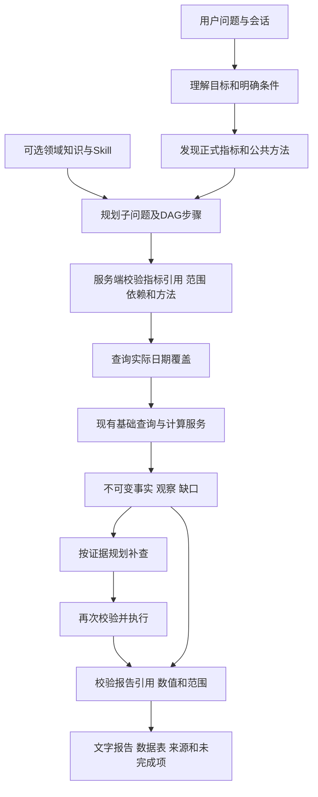

# 通用分析底座实施说明

更新日期：2026-10-15。本文描述本次新增实现；测试结果与未验证项单独记录，不能将设计目标视为投产认证。

## 1. 与原系统如何衔接

前端聊天、Pi Agent、Business Frame、账户与机构权限、正式指标目录、基础查询、日期覆盖和 Decimal 计算保持为原有组件。新增 `business_analysis` 是分析计划能力：把同一个用户目标拆成多个基础查询和受控计算，再汇总事实。

分析入口不要求预先存在主题 JSON。盈利、收入、资本等主题直接从正式指标目录发现指标；存贷款现有主题适配器保留兼容及专业口径。两种适配器复用相同任务、SQL builder、权限和计算服务，业务数值不来自模型、Skill 或验收题库。现阶段尚未把存贷款适配器全部迁移为通用方法。

图将补查展开一次以保持无环。一次用户回合默认三批取数，按主题与子问题增加，最多六批；每批计划的依赖只能引用前置节点。模型选择关注点、指标和补查方向，程序负责最终校验与执行。结构合法不能单独证明业务理解正确。

## 2. 新增文件和职责

| 文件 | 职责 |
| --- | --- |
| `agent-service/src/analysis/contracts.ts` | 通用计划 Schema、DAG 提前检查和可纠正错误 |
| `agent-service/src/analysis/bindings.ts` | 本轮目录短引用与真实签名的受控映射，减少模型抄写错误 |
| `agent-service/src/analysis/tools.ts` | `analysis_catalog`、计划执行适配器、`analysis_report_present` |
| `agent-service/src/tools/partialAnalysis.ts` | 纠错或执行预算用尽时，通过内部工具重新授权并交付本轮已有事实、表格和未完成说明 |
| `agent-service/skills/general-analysis/SKILL.md` | 跨主题理解、公共方法组合、观察与停止原则 |
| `backend-next/src/ask_metric/application/metric_semantics.py` | 正式目录描述、签名引用、元数据版本和已审核扩展 |
| `backend-next/src/ask_metric/domain/analysis_methods.py` | 计划严格类型、依赖检查、公共方法与条件 |
| `backend-next/src/ask_metric/application/analysis_execution.py` | 编译查询、日期覆盖、实际取数、计算、预算、持久化和恢复 |
| `backend-next/src/ask_metric/application/analysis_report.py` | 读取授权回执，核对数值与引用，构建表格和文字报告 |
| `backend-next/src/ask_metric/api/routes/analysis.py` | 通用分析 HTTP 接口 |
| `backend-next/config/analysis-semantics.json` | 可选语义扩展发布快照；初始为空，不预置新主题答案 |

衔接点：`tools/index.ts` 注册模型工具；`business-context/capabilities.ts`、`resolvers.ts`、`adapters.ts` 注册能力、解析器与适配器；`service.ts` 复用字段继承并防止将未限定主题的问题默认缩成贷款；`harnessHost.ts` 控制补查预算和最终报告；`routes.ts` 复核刷新与历史读取的任务及机构权限。前端沿用 `business_report` 展示路径，增加分析步骤标签及取值角色列。

模型调用 `analysis_catalog` 表示已经进入通用分析：宿主要求继续规划和执行，不能把目录命中或内部讨论当成最终答案，也不能再退回基础指标选择而丢失目标。无界“最近”误选基础查询时，返回可纠正的分析计划提示，不生成无效日期澄清。“和上个月相比”等比较基期不会替代“最近”的目标日期。

上述规划要求以查询条件能够确定为前提。正式目录若返回不同机构或统计范围的歧义，`NEEDS_CLARIFICATION` 优先于目录发现、规划预算和参数纠错：暂停业务工具，展示与服务端状态同源的确认清单。即使网关忽略 `tool_choice=none`，也不能同轮自行确认或反复校验。无状态拦截、后续参数错误不清除已保存的待确认状态；用户下一轮确认后继承原计划继续查询。机构范围歧义不按当前账号或模型猜测自动消除。

普通对话出口也有轻量门禁：原文包含查看业务表现或查数的明确措辞，并命中正式指标或原文中的机构名称/别名时，禁用普通回答工具，要求实际业务处理；网关忽略工具限制时在执行前复核。这不选择具体主题、指标和机构范围，也不是完整的意图分类器；目录之外的隐含目标仍依赖模型理解，应持续纳入验收。

贷款或存款专用分析已经开始，但用户关注项超出其主题映射时，可以继续发现完整目录，再继承机构、日期，用通用计划重新覆盖原目标。报告不混用两种适配器的原子编号；不能把主题缺配置当成全系统无数据。

“存贷款”“存贷”“存款和贷款”等组合目标按跨主题分析处理，不能仅因命中“贷款”就限定为贷款概览；已有贷款焦点也不能覆盖本轮明确的组合目标。模型通过正式目录为同一计划选择两个主题的指标，并沿用同一机构和日期目标。

计划格式错误先保持严格Schema拒绝，再由字段解析器补充具体修正办法。例如空步骤应删除，并将未覆盖的问题保留为`requirements.gap_reason`，不将缺口写到计划顶层，也不要求用户解释内部参数。

已有分析事实而连续纠错失败、工具预算耗尽或未完成交付动作时，宿主追加内部`analysis_partial_present`原生工具调用，不再只显示笼统失败。该工具不向模型暴露参数入口，不追加取数或计算：仅使用本轮成功证据，重新校验机构、基础任务或后端签名运行，再分别呈现各范围的表格、来源、已有观察及未完成项。未完成补查明确披露，跨日期和主题不混算，`partial_analysis=true`不代表原问题已经完整完成。重新授权或来源校验失败时不展示数值。

## 3. 运行协议

计划包含：

- `objective`：本轮目标。
- `scope_notice`：本次可覆盖的业务方面。
- `requirements`：需要回答的子问题，每项有独立 `id`。
- `steps`：方法、正式 `metric_refs`、回答哪些问题的 `answers`、依赖及理由。

`steps.answers` 引用 `requirements.id`，不能填写指标名或问题文本。没有步骤覆盖的子问题必须说明缺口。缺口记录会出现在最终报告中。

Agent 向模型展示本轮目录短引用（如 `k1`），持久化计划前还原为后端签名绑定；短引用不能跨用户回合使用。对应映射保存在原生目录工具回执中，同一未完成回合重开时可以恢复，目录预算也不会重置。报告原子也展示为 `e1.v1` 等短引用，提交时还原真实事实引用。两种映射都不接受模型回填事实数值，也不代替后端身份和版本复核。

模型改用了本轮目录中已经发现的精确指标编码时，服务端可将其无歧义还原为同一签名引用；未发现的编码不能借此执行。这是调用格式兼容，不是按模型自造编码猜测指标。

指标不能仅凭模型生成的编码执行。`analysis_catalog` 根据完整正式目录检索，返回名称、别名、单位、定义、口径缺口和服务端签发的 `binding_ref`。引用绑定用户、指标和元数据版本；执行前重新读取目录复核，失效、停用、伪造或跨用户引用拒绝执行。签名证明目录来源，不能证明模型选对了指标。

| 方法 | 执行行为与条件 |
| --- | --- |
| observe | 查询正式指标的实际取值；正式复合比较指标也可以直接读取 |
| compare | 查询同一指标的当前及比较日期，调用既有计算服务计算差额；正基期金额可计算取值变化率 |
| trend | 查询期间内各月最后有效观测；不跨月累加余额、不插值、不补零 |
| ranking | 在获授权机构集合和同一实际日期内排序，说明缺数；不据数值大小推断经营好坏 |
| structure | 必须提供已审核分母与分项关系，同机构、同日期、同单位，才计算占比 |

原始历史基期没有记录时，模型可以检索并读取正式复合比较指标；不会倒推出虚构的历史值。对复合差额再使用 compare 表示比较该差额的历史变化，不等于原始余额同比。

## 4. 日期、机构与覆盖

未指定机构时，后端采用当前认证账户所属机构；原文已明确机构时沿用原机构解析能力，模型遗漏的明确机构可由原文识别补齐。集合范围沿用现有机构权限与范围指纹。

未指定日期或说“最近”时，先查实际记录覆盖，再查询有效数值；较新记录无有效值时，在预算内继续回查并披露，零值是有效值。明确单日不擅自换成其他日期。明确期间逐月展示有数据的观测日期并说明缺数月份。仅有月中记录时不能称为完整月末。

默认趋势窗口是截至可用日期所在月的最近三个月，并披露该默认；明确的最近三个月等期间仍以用户原文解析范围为准。补查保持同一用户回合的机构、日期目标，并使用首批覆盖检查日作为查询上限；各指标仍按自身实际覆盖选择最近记录，不能用利润的较旧发布日遮住存贷款新数据。回读同一运行不重复消耗补查预算。

多个指标的实际截至日可能不同；事实表逐项显示日期。当前查询库没有统一批次标识，所以报告不能保证多条查询处于同一个物理快照。

## 5. 防错与故障处理

- 最终鉴权在后端；历史读取和刷新也逐任务、逐机构复核权限。
- 单回合目录发现默认四批，按正式发现的主题数量及执行计划子问题数量增加，最多十批；取数默认三批，最多六批，整轮工具预算最多三十六次。预算及已发现指标从本轮原生回执恢复。达到预算后先交付已有证据并明确未完成方向，不能认定全目录不存在。单批执行最多八个子问题、十二个步骤、三十二个不同指标、四十次基础查询和一百二十秒预算；期间最多三十六个月。预算耗尽说明未完成项。
- 通用分析准备阶段最多读取两次业务方法、两次历史状态；会话没有历史Frame时不开放历史读取和Frame执行工具，通过解析工具创建并执行新计划。目录发现预算用尽后，下一步只允许规划，避免反复读取Skill或空历史耗尽整轮工具预算。不能将空历史当作业务缺数。工具白名单与执行前复核同时生效，具体指标与子问题仍由模型选择。
- 每次运行以用户和幂等键关联，重复请求核对原计划，不重复执行已经保存的查询；并发相同请求返回运行中。已完成步骤、覆盖和查询回执写入现有会话消息存储，不新增数据库表。
- 后端临时中断可以按原键恢复未完成步骤；Agent 发送前保存执行关联，结果丢失后可只读回查已完成结果。中断和进程崩溃的全部运行场景仍需目标环境验证。
- 取数失败、结果截断、空值、无记录、基期缺失分别保留，不把失败变成零或“无数据”。
- 覆盖检查形成的缺数说明也生成服务端引用，因此明确日期完全缺数仍能交付空表和有依据的说明，不擅自改查最近数据。
- 报告从服务端保存的运行回执读取事实，不能使用模型回填的假数据。数字使用原子引用或逐字匹配本段证据的带单位显示值；表格由程序生成。
- 明确比较量的增减方向与其数学正负校验；负差额可表述为“减少”相应绝对值。允许解释执行器已检查的缺失基期、缺失月份和禁止换算说明。文案失败一次返回多个段落的问题，便于模型在有界预算内同时纠正。该规则不证明全部自然语言判断正确。
- 未知百分比编码只显示原始值，不自行乘一百或计算百分点。无审核关系不做结构分解，无监管阈值不认定达标。
- 文案校验拒绝已编码的无依据因果、监管与预测表达；连续失败可交付已核验事实及缺口。该校验不能识别所有语义错误，仍需要业务评审。

## 6. 指标变化后如何更新

新增指标首先维护到正式指标目录，通用发现不需要复制整个目录到主题 JSON。停用或修改定义后，旧的签名绑定在新执行或新报告校验时失效，需要重新发现规划。

需要补充频率、存量/流量、比例编码、方向或分项关系时，维护 `analysis-semantics.json`。扩展严格校验 Schema；只有 `status=approved` 且注明依据的字段与关系参与计算，草稿不参与。涉及某指标的已审核关系变更也会改变其绑定版本。

该文件是当前的发布快照载体，尚无新增的审核管理页面、多人审批和原子发布中心。正式投产应将审核工作流接到现有目录治理，再发布版本化快照；不要让模型自动把网络文章写成银行正式指标口径。

更新顺序：维护目录及依据 → 审核扩展 → 静态与契约检查 → 受影响方法回归 → 真实库核对 → 保留题复测 → 灰度。元数据变更不能只改文档或提示词。

## 7. API 与部署

接口均位于现有后端，使用现有 Bearer 认证：

| 接口 | 用途 |
| --- | --- |
| `GET /api/v1/analysis/catalog?keyword=...&page=1&page_size=12` | 正式指标发现及签名引用 |
| `GET /api/v1/analysis/methods` | 公共方法及条件 |
| `POST /api/v1/analysis/validate` | 严格校验计划及绑定，不取业务数值 |
| `POST /api/v1/analysis/execute` | 执行计划，必填 `Idempotency-Key` |
| `GET /api/v1/analysis/runs/{key}?conversation_id=...` | 只读回查原运行状态及完成回执 |
| `POST /api/v1/analysis/report` | 汇总同一回合、机构及日期目标的最多六份回执 |

本次没有新增三方依赖、数据库迁移或新的连接秘密。升级需同步 Backend、Agent、业务 Skills、前端和新配置；现有打包器会复制后端 config 目录及 Agent skills 目录。不能只更新提示词或只替换前端。回退应用代码时保留分析运行消息和旧任务；旧版本不认识的新回执可能不能读取，宜先停止新分析并保留已发布版本备份。

## 8. 验收与投产门槛

隔离测试用合成样本验证协议、权限与故障，真实模型验收使用现有配置指向的实际查询库，二者必须分别报告。公开报告只提供问题方向，不提供项目验收的业务数值。

本次开发验收的问题来自银行官方报告的管理层分析关注点，包括盈利、利息及非息收入、资产质量、拨备、资本、存贷款及多期变化；具体问题是据此改写的测试题，不是银行领导原话。验收记录、模型错误和独立只读 SQL 核对结果保存于本机 `local-artifacts/reports/`。

投产前仍需业务人员审定指标选择、正式口径与关系，建立独立保留题集并重复验证；执行目标环境并发、重启、超时、权限变化、版本发布与回退验证。有限样例、JSON合法、没有澄清或模型自评均不能证明“任意问法都正确”。

## 多方面分析的覆盖与交付

通用目录复用领域增强中的 `bind_metrics`：编码或完整名称/别名唯一匹配，并校验单位和取值口径。搜索同时返回已绑定的领域总量、可探索指标及 `analysis_hint`；有冲突或禁用的映射不采用。没有专项主题的指标继续由正式目录发现，不要求新增主题配置。分组提示不等于审核后的分解关系，也不保证当前机构有值。

Agent 保存本轮正式候选及其短引用。多方面经营概览取数后生成 `coverage_review`，对已发现领域的规模、比较、主要构成及质量检查是否尝试；有可执行候选和剩余预算时要求补查。聚焦结构、质量或增长的问题只检查相应方向，单指标取值不强制扩展。重复的相同机构、日期目标及方法/指标计划不再取数，返回可纠正的复用或换候选提示。

报告必须保留首批原始计划。后端根据原始子问题、执行步骤、正式指标及报告段落的原子引用核对覆盖，不能只交付最后一次补查或漏掉已有证据的子问题。预算内未检查的方向作为 `planning_gaps` 进入缺口，报告标记部分完成。该检查确认执行和证据覆盖，不证明全部自然语言推理正确。

报告最多十二个章节，每段最多二千五百字符，摘要最多二千字符；没有最低字数。简单问题简答，多方面问题由 Skill 指导逐项展开发现、比较、进一步线索及边界，不能通过重复数值或编造原因增加篇幅。不同截至日不直接进行跨主题归因。

模型响应失败时先保留原生有界重试。重试耗尽且当前回合已经取得分析事实时，宿主通过内部部分交付工具重新验证授权和基础任务，显示事实表格并明确标记模型失败、完整分析未完成；不由模型补写结论。取数前失败、取消、撤权或交付复核失败时，不把未知结果当成成功数据。

目录的 `k` 短引用只用于当前回合的工具绑定，不是业务指标编码。报告缺口和可展开的问题说明会清除临时编号，正式 `ORG_` 编码按当前目录转换为指标名称；原始规划仍保留在运行回执中供排查。缺口只描述未完成事项，不应放入已发现、可查询指标的工作笔记。历史报告不会因升级自动重新生成。

数据表中包含口径提示的长显示值在单元格内完整换行；未知百分比数值编码仍展示原始值及提示，不能为了显示为百分数擅自换算。

## 经营报告的结构化展示

通用报告与存贷款专项报告均在 `report.presentation` 提供版本化展示信息（`version=1`）：`scope` 是已核验的机构和观测期间，`source_notices` 是数据来源及默认条件说明，`limitations` 是口径和解释边界。结论与各分析段落继续使用 `report.summary`、`report.sections`，缺口使用顶层 `gaps`；所有数值仍从原运行证据引用。

前端将该结构映射为可选的 `ChatResponse.analysis_report`，展示报告正文和可展开的完整数据明细；自然正文不强加固定栏目。页面不再展示“部分完成”标签、“未完成项与数据缺口”卡片或“数据来源与分析依据”折叠区。影响判断的数据限制在正文末尾简短说明，来源、口径、分析计划和真实完成状态仍保留在结构化回执中。图表沿用既有数据适用性判断，不为缺少连续日期的结果生成趋势。原始 `public_answer` 保留完整报告，供复制、旧客户端和历史兼容；没有完整展示契约的旧会话继续按原正文展示。单指标查询不强制套经营报告。

报告正文使用短标题、自然段和少量重点强调，内容组织仍由问题与证据决定。Agent 在事实校验前将代码片段外重复转义的段落换行规范化；前端同样兼容历史消息，Markdown 渲染时将超过一百个字符的异常标题恢复为普通段落、超过八十个字符的连续加粗恢复为普通字重。只调整排版标记，不解码任意字符串，不改写数字、日期、引用、链接或代码，不增加模型重写轮次。正常短标题、重点短语、列表与表格继续保留。

章节数量和分析深度取决于用户子问题、实际覆盖与有效证据，不在前端按业务关键词补写段落，不以固定字数凑报告长度。多方面问题仍要求每个已取到证据的子问题有对应章节；缺数、比较基期缺失或文案校验未完成必须披露。

“和上个月、去年同期相比”等列举的比较基期与观测期间分别处理。追问仅改变比较方式时继承原有观测范围；明确问“上个月情况”才改查目标月份。服务端忽略模型把纯比较基期误填成目标日期的参数。相同回合、机构、日期目标及指标方法的重复计划返回成功的复用控制回执和原 `evidence_ref`，不重复取数或登记事实；补查仅提交新增步骤，报告保留首批证据。

升级时需同步后端报告模块、Agent 源码与 Skill、前端，并重启后端和 Agent。没有新增数据库迁移或依赖。只更新前端仍可读取旧结果，但不会启用新版布局；旧客户端可继续读取完整正文。

### 取数后的分析深化

通用执行器从已绑定领域指标的语义映射返回 `followup_metrics`，优先提供较上月、较同期的正式差额指标，最多二十四项；不拼接不存在的编码，不额外查询业务数据，不证明指定机构有数。Agent 将其登记为本轮短引用，补查仍走原有计划、鉴权、覆盖检查和取数接口。新增短引用随原生执行回执保存，恢复时不额外消耗目录检索次数。没有领域映射的主题继续通过正式目录探索，不将配置缺失等同于无数据。

`coverage_review` 除现状覆盖外，检查已关注的主要构成及质量指标是否尝试了可用比较；已查无记录视为已尝试，避免循环查询。每个方向优先检查两个已取现状指标，仍受原有总轮次与查询预算限制。

`analysis_brief` 根据实际差额的正负方向提示同机构、同观测日、同正式比较期间的分化，以及同一指标在不同基期下的方向差异。它只提供带证据引用的分析问题，不计算贡献、不判断业务原因或监管达标。模型据此选择重点并组织“发现、关键差异、业务含义、具体核查方向”；公共方法与专项 Skill 共同指导，简单取值问题仍可简短回答。报告继续由原有证据校验器校验数字、日期和部分不支持的业务断言，不能把这类校验视为对所有自然语言结论的完备证明。

请求绑定业务 Frame 时显式继承本轮目录状态，避免执行上下文副本丢失候选、短引用重号或覆盖检查失效。已确认编码的比例差额展示为百分点，比例水平及增幅展示为百分比；数值编码未知时保留原始显示。

报告在有界纠错后仍有文案失败时，服务端逐段复核，保留通过校验的摘要和章节，并显示被省略内容的提示。所有段落均不可用时才退回事实清单；数字、权限、范围与正式引用的复核不放宽。明确提出需核查的动因问题可以展示，未经证实的增长贡献或实际原因仍不能作为结论。

段首、冒号或分号后的建议序号按排版处理，不作为业务数值；建议正文中的金额、比例和其他数字仍须关联已核验事实，避免多条核查建议被误删。同比与较年初分别对应上年同期和年初，不能在结论中合并为同一比较基期。
