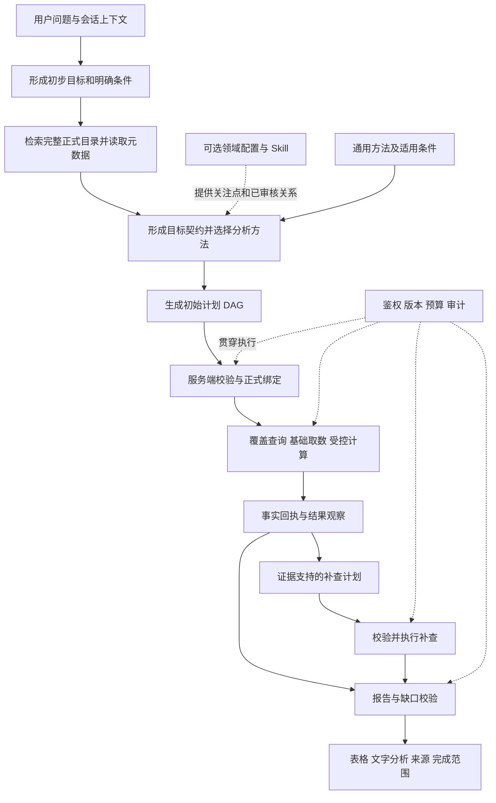

# 通用分析底座与领域增强：建设与可靠性设计

状态：目标设计；2026-10-15 已开始实现公共核心，已实现范围与实际验证见[通用分析底座实施说明](通用分析底座实施说明.md)。

本文保留完整建设目标及投产门槛，不能将其中全部内容理解为已经实现。公共核心已接入正式目录发现、通用计划、原有取数计算和证据报告；审批发布、容量与完整业务保留题验收等仍按阶段推进。实现说明与本机验收记录分别描述代码状态和实际执行的验证。

## 1. 目标与适用边界

所有主题共用“理解目标、发现指标、选择方法、执行查询、观察结果、补查和报告”的同一执行体系。基础查数是其中只有少量步骤的计划；复杂分析由多个基础查询和计算步骤组成，继续复用相同的权限、状态、取数与事实体系。

存款、贷款等领域配置提供更专业的关注点、关系与方法参数。没有专项配置时，也应从完整正式目录寻找相关指标，完成有依据的现状、比较、趋势、排名等分析。不能因为没有主题 JSON 就直接拒绝。

“能够分析”的必要条件是：目录中存在可识别的相关指标、用户有权限、查询库有适用记录，且所选方法要求的口径能够确认。不能仅凭指标名称推断公式、层级、因果、可加总性和风险好坏。宽泛经营问题应披露本次实际覆盖的方面，不能把可查到的少数指标包装成全部经营状况。

“始终有回复”指始终交付明确的处理结果：完整报告、部分分析、无数据说明、必要澄清或服务故障说明。服务失败、证据不足时不能为了有答案而生成业务事实。

### 1.1 动态多机构分析目标

分析对象使用运行时确定的机构集合，不围绕“两家对比”建立专用流程。两家、十家、二十家等数量共用目标、鉴权、执行和报告机制；业务对象数量与单批技术容量分别管理，必要时分批执行后核对全部目标覆盖，不静默丢弃机构。机构集合去重，成员顺序不改变业务范围；新增、移除、排除和继承机构必须显式记录并保持后续追问一致。

用户要求逐家对比时，提供覆盖全部目标机构的对比表；宽泛分析围绕全体有效证据形成总体判断，再按问题选择重点机构和差异，不能按输入顺序只取前几家推断整体。正文展示数量与实际参与分析的机构数量分别管理，摘要不能代替完整取数与计算；排名、均值、差异等由程序按明确口径计算，缺数及不可比项单独保留，不能补零或混用不同日期。

验收至少覆盖一、二、五、十、二十家机构及顺序变化、增删成员、部分缺数、不同观测日和多轮主题收窄。此处为后续建设与验收约束，不表示这些规模已完成真实服务验收。

## 2. 当前项目可复用的部分与实际缺口

| 范围 | 当前源码情况 | 设计中的处理 |
| --- | --- | --- |
| 前端、会话与上下文 | Pi 会话、Business Frame、Delta、历史引用和流式结果已存在 | 保留入口与状态体系，增加分析运行和子步骤关联 |
| 正式指标目录 | 有编码、名称、别名、说明、单位、来源编码、基础名称和部分口径字段 | 提供按引用读取完整元数据的接口，逐步补齐方法所需字段 |
| 目录检索 | 有词法检索、分页信息和可选 embedding 近似推荐 | 复用召回；增加分层发现、正式绑定和漏项检查 |
| 主题规划与执行 | `OverviewPlan`、`OverviewRequest` 限定 `loan/deposit` | 新增通用分析协议，保留现有主题增强的兼容入口 |
| 其他综合分析 | `businessCapability.ts` 可以直接返回不支持并结束 | 根据可用方法和证据完成可执行部分，再说明真正缺失的能力 |
| 原文指标识别 | 基础问数通过 `{fromQuestion:true}` 等方式约束指标来源 | 保留明确查询的保护；新增有目录证据的探索指标绑定方式 |
| 查询、覆盖、计算 | 结构化基础查询、日期覆盖、后端鉴权、SQL builder 和事实计算已存在 | 作为通用计划的执行原语，不另建绕过治理的查询链路 |
| 报告 | 经营报告主要接收同主题、同范围的概览证据 | 增加通用证据适配及按范围分组的报告协议 |
| 语义维护 | 专项 JSON 承载部分指标关系、公式和缺口 | 逐步形成有来源和版本的语义扩展，JSON 可继续作为发布快照 |

目录结构对应 `domain/semantics.py` 的 `MetricCatalogItem`，并不已经具备完整的统计频率、分项互斥关系、可加总性和业务方向等字段。检索返回的条目也不能代替完整元数据读取。现有目录缓存的更新时间与数量键可继续用于进程缓存，但不能直接当作跨目录、关系和规则的原子发布版本。

## 3. 总体架构与有向无环执行图



图中把补查展开一次以保持无环。实际运行可以追加有限批次，每个新节点只能依赖已存在的前置节点，不能回指形成环；计划追加必须经过校验。已执行节点及事实不可就地覆盖，纠正通过新版本与替代关系表达。

只有一套分析运行机制。一次简单取值可直接形成单个基础查询步骤；宽泛分析会先发现指标、探查覆盖、执行多步计划。是否调用领域增强，由实际目标和元数据决定，不能设置“未匹配某个 Skill 就不能分析”的入口门槛。

### 3.1 模块分工

| 模块 | 职责 | 执行主体 |
| --- | --- | --- |
| 目标理解 | 解释语言、理解上下文、提出需要回答的子问题 | 模型提出，原文与可信会话状态约束 |
| 指标发现 | 召回相关指标，读取定义与可用维度，建立候选证据 | 模型选择检索方向，程序执行检索与绑定 |
| 方法选择与规划 | 选择现状、比较、趋势等方法，组织依赖关系 | 模型提出计划，程序检查方法前提与显式条件 |
| 计划执行 | 调用覆盖、查询、计算，管理重试、幂等和状态 | 服务端确定性执行 |
| 结果观察 | 计算差异、识别缺口、发现需要进一步查看的分项 | 程序生成事实观察，模型判断下一步价值 |
| 报告交付 | 组织结论、表格与解释，核对证据和未完成目标 | 模型组织文字，程序渲染事实与强校验 |

模型的作用贯穿选择与组织，程序的作用贯穿约束与执行。结构合法只能证明满足已编码规则；“是否理解得合适”还需要业务评测和抽样复核。

## 4. 业务语义层如何建设

### 4.1 以正式目录为基础，按分析方法逐步补齐

不再为每个业务领域复制一份完整指标清单。正式目录继续保存已有的指标身份与基本说明；新增的语义扩展以指标身份关联维护。需要区分三个层次：

| 层次 | 内容 | 缺失时的处理 |
| --- | --- | --- |
| 身份与来源 | 正式编码、名称、别名、定义、启用状态、来源、原始单位 | 身份无法确定不取值；单位不明不做换算 |
| 方法所需属性 | 余额/日均/期间发生额、统计频率、累计方式、数值编码、可用维度、是否可加总 | 禁用依赖这些属性的方法，仍可展示可确认的原始事实 |
| 关系与业务判断 | 分类树、构成关系、分母、公式、同口径比较、业务方向、关注优先级 | 不做无依据的结构贡献或好坏判断，保留现状和有依据的比较 |

数据可用性属于运行时查询结果，不能永久写进语义配置后当成事实。指标元数据与数据覆盖分别版本化、分别说明。

复合指标在执行层仍是独立正式指标。可审核补充“基础指标、数值口径、比较方式、排名口径”等属性，但不能仅根据名称或编码后缀自动认定其等价关系。已有正式同比、增量或排名指标时，先确认是否与用户目标一致，再决定直接引用还是按批准公式另算；两者不一致时展示口径差异，不强行对齐。

### 4.2 配置、知识库与 Skill 的分工

| 载体 | 应放内容 | 如何影响执行 |
| --- | --- | --- |
| 结构化语义记录 | 指标定义、单位编码、适用频率、关系、批准公式、业务方向及来源版本 | 可作为绑定、方法准入和计算依据 |
| 通用方法注册表 | 方法输入、适用条件、允许计算、输出证据、停止条件 | 程序据此判断是否能执行 |
| 通用 Skill | 如何理解目标、挑选方法、观察结果、组织报告的策略与示例 | 指导模型选择，不替代执行校验 |
| 领域增强 | 存贷款等专业关注点、审核后的分解关系和方法组合 | 在同一计划中提高专业性，缺失不阻断通用方法 |
| 解释知识库 | 专家经验、政策背景、业务解释方向、适用条件与出处 | 支持解释及后续核查建议，不能充当当前机构事实或直接授权公式 |

第一阶段不必新建独立知识库平台、知识图谱服务或向量数据库。先利用现有目录检索和可选向量能力，补充结构化关系与元数据读取。关系复杂到现有存储难以维护时，再评估专门设施。

参考报告适合提炼分析步骤、证据要求和表达方式。历史机构、日期、数值不直接进入当前事实区；原文检索结果作为带来源的参考材料隔离，不能修改工具权限与执行规则。模型从资料中提炼的关系只能成为待审核草稿。

### 4.3 指标变化如何更新

1. 接入现有目录同步和管理流程，接收新增、停用、别名、单位、口径等变化，保留差异与来源。
2. 程序检查编码冲突、单位编码矛盾、关系循环、失效引用、公式输入及版本兼容性；模型可以提出整理建议。
3. 业务负责人审核定义、分项关系、比较口径和公式。未审核部分不得自动进入可执行规则。
4. 发布一份语义清单，绑定目录、关系、方法规则的版本或内容摘要；需要历史口径时保留生效区间。
5. 刷新检索与缓存，运行受影响的方法回归。历史任务继续保留原版本证据；新执行重验当前权限与启用状态。
6. 若来源目前不支持历史有效期或数据批次，明确记录该限制，不能声称支持任意历史口径重放。

JSON 可作为版本化发布快照，维护入口应逐步接入现有管理能力。程序负责同步和一致性检查，业务负责决定含义；无需为每个问法新增配置。

## 5. 如何把“理解用户目标”变成可检查的技术过程

### 5.1 从初步理解到目标契约

第一次模型理解只是工作假设。它先结合原文与上下文提出检索词，读取相关目录说明，再形成目标契约 `IntentSpec`。该契约至少包含：

- 用户实际希望回答什么，以及需要回答的子问题。
- 原文明示的指标、机构、日期、口径、比较对象和排除条件，保留原文依据。
- 从可信会话继承的条件及来源 Frame；明确条件优先于继承条件。
- 机构与日期采用了哪些默认规则，以及这些规则的服务端依据。
- 预计交付什么：当前值、期间表、排名、变化分析或有边界的解释。
- 当前尚不确定的内容；哪些可以自动处理，哪些会实质改变结果而必须澄清。

服务端核对原文范围、已识别实体、明确日期、否定条件和可信会话条件。不能让模型将“五月到十月”缩成十月，将“最近”猜成当月月底，或把“不含协定”替换为“含协定”。这些校验应复用或扩展现有 Resolver/Validator。

子问题和方法之间建立映射：每个明确要求都必须有计划节点，或有“无法执行及原因”的处置记录。不能因为一部分指标容易查，就丢弃用户其余目标。

### 5.2 指标发现不等于指标确认

复用目录搜索进行分层检索：先按主题词找候选，再读取候选的完整定义、口径和关系；必要时扩展别名或语义检索，并处理分页、截断与检索失败。宽泛问题可参考已有正式业务分类；若没有分类，则按检索结果组织有限范围，并披露覆盖边界。

必须区分两种指标来源：

- `explicit`：用户明确指定，沿用现有原文识别与确认保护。
- `discovered`：系统为回答宽泛目标而通过目录发现，必须携带服务端检索引用、元数据引用、选择原因和对应子问题。

拟新增 `CatalogBindingRef`，由服务端生成和解析，关联当前分析运行、目录记录、版本与查询来源。模型提交引用，不能提交任意编码冒充已确认指标。执行前再次检查身份、状态、权限及口径。

当前的 `exact/contains/lexical` 属于检索方式，不能单独证明语义选对；embedding 分数也不等于准确率。近似推荐必须经过新的正式解析与校验才能成为可执行绑定，不能仅以分数过阈值自动采用。

对于用户明确且实质歧义的指标，保留必要澄清。对于宽泛概览，允许按已审核关注优先级和方法条件选择可用指标，说明采用范围；不能把模型检索排序声称为“银行最高关注度”。没有优先级元数据时，不虚构业务重要程度。

### 5.3 少澄清的具体规则

| 条件 | 默认处理 | 需要澄清的边界 |
| --- | --- | --- |
| 未指定机构 | 采用可信的账户归属机构或明确的会话机构，并说明 | 无唯一默认机构、候选会实质影响结果时才问；不自动扩大为全省 |
| 未指定日期或只说最近 | 检查覆盖，选择本次主要指标的最新适用记录 | 语义是期间走势时还需确定窗口，采用已发布默认窗口并披露；不能把走势缩为单点 |
| 明确日期 | 严格查询指定日期；明确范围则在范围内处理 | 日期无法解析且不同解释影响结果时才问；不能悄悄越界找旧数据 |
| 宽泛“情况怎么样” | 自主发现指标，按可用证据选择方法，说明分析范围 | 不把内部方法枚举和日期取数模式交给用户选择 |
| 指标口径冲突 | 先读取正式定义、会话确认和审核默认规则 | 含/不含、余额/日均等仍无法唯一确定时，简短澄清或展示可确认部分 |

默认规则由程序执行、记录来源并允许用户修改，不能只写进提示词。

## 6. 通用方法如何覆盖灵活问法

不按“存款概览”“贷款概览”“利润概览”复制一批执行框架。先建设少量方法组件，由模型结合目标和指标属性组合。共同方法不意味着每个问题套用相同章节。

| 方法 | 所需依据 | 允许输出 | 不能默认做的事 |
| --- | --- | --- | --- |
| 现状 | 正式指标、机构、适用日期和实际值 | 当前规模、水平、可用范围 | 未知业务方向时判定好坏 |
| 比较 | 可比期间、机构、单位和统计口径 | 差额、批准的增长率、百分点变化 | 将累计值当月发生额，跨口径比较 |
| 趋势 | 多个有效时间点及频率说明 | 可核验的升降、拐点和波动描述 | 单点当趋势，插值冒充实际记录 |
| 排名 | 明确且获授权的比较集合、共同口径及适用日期 | 集合内排名和覆盖情况 | 用不完整样本声称全省排名 |
| 结构 | 明确分母与已审核分类或构成关系 | 分项、占比、结构变化 | 名称相似就视为子项；互相重叠的分类直接相加 |
| 变化分解 | 同口径的可加总关系、互斥和完整性依据、对账结果 | 增减来自哪些可核验分项、残差和贡献 | 将账面分项变化解释为客户行为等业务因果 |
| 问题定位 | 明确比较基准、目标值或已批准阈值 | 偏离发生在哪些指标与维度 | 把偏离自动称为异常，或对未来作承诺 |

每个方法有两部分：Skill 提供选择与观察策略；代码中的方法注册表执行输入和适用条件校验。公式、单位换算和前提条件必须由程序实现或引用批准规则，不能只依靠 Markdown 约束。

同比、环比、较年初需要区分存量、期间发生额和累计量；百分比差值需要区分百分点与相对变化率。基期为零、负基期、非完整月份、季度指标缺月等按批准政策返回适用结果或缺口，不交给模型自由解释。已有查询或计算工具不能支持的方法，应明确标为待建设，不能先开放名称再假定可执行。

领域 Skill 可以建议优先看什么、何时继续分解、如何解释，但所引用的关系与公式仍须来自可追溯语义记录。Skill 选错时，方法前提和目标覆盖校验应拒绝不适用步骤；相关性仍可能判断有误，需要盲测与人工复核持续发现。

## 7. 通用计划、证据与报告契约

以下是拟新增的概念契约，字段名和代码位置在实现阶段细化，不代表当前接口已经支持。

```text
IntentSpec
  objective / requirements[] / explicit_constraints / inherited_constraints
  defaults_applied[] / requested_output / unresolved_items[]

AnalysisPlan
  run_id / plan_version / intent_ref / semantic_manifest_ref
  bindings[] / steps[] / budget / requirement_dispositions[]

PlanStep
  step_id / answers_requirement_ids[] / method_id / method_version
  input_binding_refs[] / depends_on[] / applicability_evidence_refs[]
  output_contract / optional_or_required / stop_conditions

EvidenceAtom
  evidence_id / run_id / step_id / source_task_or_calculation_id
  metric_identity / org_scope / actual_date / value / unit / value_basis
  catalog_and_rule_versions / input_fact_refs[] / data_revision_if_available
  retrieval_time / quality_flags[] / provenance

AnalysisReport
  run_id / status / requirement_dispositions[] / tables[] / claims[]
  sources[] / defaults_applied[] / gaps[] / unresolved_errors[]
```

### 7.1 服务端在执行前检查什么

1. 指标引用真实存在、版本相容、状态有效，原文明示条件没有被探索指标覆盖。
2. 机构和数据权限有效；每次取数、回读和最终交付都按现有安全边界重验。
3. 日期和频率符合目标；比较对象完整，范围展开符合现有接口上限。
4. 方法的单位、口径、关系、分母和计算前提有依据。
5. 计划无环、输入输出类型匹配，依赖引用有效，预算可承受。
6. 每个明确子目标都有执行路径或公开缺口；计划不能悄悄减少目标。

校验通过后编译为现有 `BasicQuerySpec`、覆盖请求和计算请求。模型不提交 SQL，不绕过 `task_service.py`、`query_execution_service.py` 和计算事实授权。

### 7.2 运行状态与多轮衔接

在现有会话持久化中增加版本化 `AnalysisRun` 状态，关联根目标 Frame、子任务、计划版本、证据引用、预算和最终处置。不另建与现有 Frame 竞争的会话焦点系统。

初步状态包括规划中、校验中、执行中、观察中、交付中，以及完成、部分完成、等待澄清、失败和取消。前端刷新或 SSE 重连时读取持久状态，不能把模型最后一句话当作任务成功。

同一问题的辅助查询使用 `supporting` 角色，不夺取原目标的机构、期间和焦点。用户说“那上个月呢”时，继承原问题的业务目标；用户明确切换主题时重新选择相关指标。并发使用已有版本控制避免旧请求覆盖新焦点。

历史结果只能在重新授权后引用，计算继续遵守本轮事实范围。需要跨轮计算时按既有事实规则重新查询或建立受审核的显式引用能力，不能把旧 `fact_id` 伪装成当前取数。

### 7.3 如何按证据补查

程序先生成可核验观察，如某项差额最大、某时间段缺数、分项无法对账、比较基期不足。模型再判断这些观察与用户目标的关系，并选择补查。

每次补查必须写明要回答的子问题、触发证据、指标来源和预期信息。补查节点只能使用真实目录与已审核关系；没有分项关系时可查询相关指标并列观察，不能声称构成分解。

没有新的可查依据、已回答目标、连续补查没有新增有效证据、预算或截止时间到达时结束。不能为了展示“自主思考”强制补查，也不能重复执行同一查询制造过程。

### 7.4 数字可追溯之外，还要校验结论

表格、单位换算和数字通过事实引用渲染；比较差额、方向、排名和对账来自受控计算。每条分析结论关联其子目标与证据范围，跨机构或跨期间结论必须明确比较关系。

常见事实判断可采用结构化 Claim，例如“某指标在两个期间之间增加”，服务端根据已计算事实验证方向和幅度，再渲染文字。模型自由组织的解释文字检查来源、范围和不支持的因果表述，必要时进行独立评审或人工抽查。

数字能找到出处，不等于文字结论一定正确。系统不能仅靠数字占位符声称消除了幻觉；自由文本仍存在相关性和解释偏差风险。校验失败时先定向修正，仍失败则交付程序可验证的表格、事实摘要与缺口，并标记部分完成，不能把删去的目标当成完成。

## 8. 日期、数据覆盖与一致性

### 8.1 最新日期的选择

“最近”或未指定日期时，服务端先根据目标和主要指标探查有效覆盖，选择适用的截至日，说明当前业务日期、实际数据日期、所用默认规则和滞后情况。零值是有效值；空值、错误值和缺失不能混作零，也不能仅依据存在一行记录就认定可分析。

主要指标由明确目标、审核优先级或已披露的选择策略确定。不能为了让所有可选指标同日齐全而退到很早的共同日期。补充指标可使用各自最近适用日期，但在表格中标明，并禁止直接进行不合适的横向比较或对账。

跨机构排名需说明比较日期和实际参评集合。不能将不同机构各自最新日期混用后声称同日排名；若无法形成适用共同日期，交付可比部分及未参评说明。

### 8.2 明确日期和期间的处理

- 用户指定某一天：严格查该日；无记录时明确说明，不自动改用上月。
- 用户指定月份：区分截至当日、月末和整月发生额；月末是否完整由元数据和覆盖证明。
- 用户指定五月至十月：在该范围内组织适用时间点，显示缺失月份和实际末次日期；十月缺数不妨碍交付已覆盖月份。
- 用户指定最近三个月：保留完整期间目标，不只展示一个最新值；默认窗口的锚点与来源应披露。
- 新增指标的频率或覆盖不同：分组说明，不能把季度值当作某月真实值。

### 8.3 不变回执与真实数据快照的区别

所有取数回执保持不可变，以便审计；这不能自动保证多次查询来自数据湖同一个物理批次。若数据源提供批次或快照标识，应绑定并检查。若没有，应记录读取时间、查询指纹和元数据版本；检测到同一条件数值冲突时重取受影响依赖或终止该比较，不能静默混合。

报告的数据来源应区分：指标定义来自何处、数值来自哪个授权查询数据源、实际统计日期及必要的计算来源。可以证明“来自项目当前查询库”，不能在未核实上游链路时进一步声称“已经证明全部是银行生产原始事实”。

## 9. 稳定性、错误恢复与降级

### 9.1 明确区分错误状态

| 情况 | 处理方式 | 最终交付 |
| --- | --- | --- |
| 参数或计划不合法 | 返回字段级原因，允许有限次模型修正 | 无法修正则说明未执行部分，不转嫁内部枚举给用户 |
| 无匹配记录 | 保留原范围，核对已批准的覆盖策略 | 已有事实加无数据说明，不称为工具失败 |
| 口径歧义 | 可默认的按审核规则处理；关键歧义保留 | 可确认事实加简短必要澄清 |
| 超时或临时服务故障 | 在总截止时间内按幂等键有限重试 | 已成功部分、未完成任务和原因 |
| HTTP 401/403 或权限撤销 | 停止相关访问，不尝试绕过 | 鉴权或权限说明，不把失败解释成无数据 |
| 模型 HTTP 402、额度或授权不可用 | 不重复消耗式重试；保存已执行状态 | 服务不可用说明；已有授权事实可由程序摘要交付 |
| 元数据发布或数据冲突 | 按版本策略重验、重编译受影响步骤 | 无法保持一致时停止相关比较并说明 |
| 报告生成失败 | 重试修正文案；仍失败则程序渲染事实 | 明确标识部分完成及缺口 |

错误原因必须保存在运行状态中。一次后续成功只能消除确实已解决的前序错误，不能掩盖其他失败或未完成目标。

### 9.2 对资源和执行过程设边界

建议试点从最多两批补查、单步最多一次临时错误重试、单轮总截止时间 120 秒开始。其余上限（计划节点、实际查询任务、返回记录、并发度、检索分页、模型 token）结合已有接口限制和目标环境压测确定，不将试点数值直接当作生产容量。

预算必须覆盖实际展开的查询任务，不能只限制模型调用次数。独立步骤允许受控并行；有依赖的查询顺序执行。相同运行、范围、版本和步骤使用稳定幂等键；幂等不代替权限重验。缓存键包含必要的权限范围、元数据版本、日期与数据版本，不能跨用户泄露结果，也不能以缓存时间冒充统计日期。

用户取消或请求超时应传播给子调用，已落库任务按真实状态记录。后端仍在处理时交付待确认状态，不能因前端超时认定查询已失败或已成功。

### 9.3 提供可检查的过程

前端展示：理解到的目标、采用的机构日期、准备回答的子问题、实际执行步骤、补查触发原因、数据来源与未完成项。这些内容来自计划和执行回执，不展示或依赖模型隐藏推理。

模型、提示词、Skill、方法注册表、语义清单和执行协议都有版本。继续按用户指定的 DeepSeek V4 Flash 服务配置进行后续联调，记录模型版本和采样配置；是否开启深度思考不作为正确性的保障。审计用同一 `run_id` 关联步骤和耗时，日志记录脱敏诊断，不记录凭据或无必要的完整业务数据。

## 10. 与当前项目的文件衔接

### 10.1 优先复用和修改的现有文件

| 文件 | 改造职责 |
| --- | --- |
| `agent-service/src/prompts/businessSystemPrompt.ts` | 保留通用理解与工具原则，减少按业务域堆积提示词 |
| `agent-service/src/tools/catalog.ts`、`metricCatalogSearch.ts` | 复用检索，扩展正式引用与元数据读取；保留近似候选与正式绑定的区别 |
| `agent-service/src/business-context/types.ts`、`capabilities.ts`、`resolvers.ts`、`service.ts` | 接入目标、计划和发现指标的解析校验，保持明确条件与继承规则 |
| `agent-service/src/business-context/adapters.ts` | 将已校验步骤转交现有查询、覆盖与计算能力 |
| `agent-service/src/harnessHost.ts` | 衔接运行状态、预算、追加计划、取消和最终交付 |
| `agent-service/src/tools/businessCapability.ts` | 去除其他主题综合分析的笼统拒绝；保留预测等真实能力边界 |
| `agent-service/src/tools/businessOverview.ts` | 作为已有领域增强的兼容适配入口，逐步输出通用计划和证据 |
| `agent-service/src/tools/businessReport.ts`、`answerEvidence.ts` | 增加多类事实适配、结论校验和范围分组，保留现有报告兼容 |
| `backend-next/src/ask_metric/application/catalog_search.py` | 复用检索与排序，不把检索相似度提升为语义确认 |
| `backend-next/src/ask_metric/domain/semantics.py`、`backend-next/src/ask_metric/infrastructure/semantic/catalogs.py` | 暴露完整指标描述，关联待建设的语义扩展与发布版本 |
| `backend-next/src/ask_metric/application/data_availability.py` | 复用覆盖查询，补充方法所需的有效性与覆盖解释 |
| `backend-next/src/ask_metric/application/task_service.py`、`query_execution_service.py`、`calculation_service.py` | 保留事实、鉴权、SQL 生成、计算与幂等边界 |
| `backend-next/src/ask_metric/application/business_overview.py`、`overview_evidence.py` | 提取可复用的覆盖、比较、证据适配能力，保留领域特殊口径 |
| `backend-next/config/business-topics.json`、`business-knowledge.json` | 保留已有领域增强，逐步迁移重复目录内容与审核后的关系 |
| `frontend-vue/src/components/chat/BackendNextChatPanel.vue`、`ChatResultContent.vue` | 展示计划、分组表格、来源与真实完成状态；保留现有会话恢复 |

### 10.2 建议新增的模块边界

以下为建议目录及职责，不代表已创建代码文件；优先作为现有三个服务内的模块，不增加独立微服务。

| 建议位置 | 职责 |
| --- | --- |
| `agent-service/src/analysis/` | 目标/计划协议、方法选择、预算、观察和运行状态编排 |
| `backend-next/src/ask_metric/application/metric_semantics.py` | 正式指标描述、探索引用解析、语义版本与关系读取 |
| `backend-next/src/ask_metric/application/analysis_execution.py` | 权威校验、计划编译与已有服务调度，逐步收拢可复用校验 |
| `backend-next/src/ask_metric/domain/analysis_methods.py` | 方法适用条件、类型规则与批准计算策略 |
| `agent-service/skills/general-analysis/SKILL.md` | 跨业务主题的理解、方法组合和观察策略 |

协议在跨服务边界有版本与契约测试，Agent 的提前检查用于反馈与编排，Backend 保留执行所需的最终鉴权与数据规则；避免同一业务公式在两种语言分别维护。持久化扩展采用增量迁移和回退说明，不改写已发布迁移。

## 11. 建设顺序与每阶段的交付门槛

### 阶段一：整理公共契约和语义缺口

- 盘点正式目录与现有查询接口，明确能执行的方法、需要补充的元数据、已有接口限制。
- 定义 `IntentSpec`、`AnalysisPlan`、`EvidenceAtom`、`AnalysisReport` 与版本规则。
- 完成完整元数据读取和发现引用的设计，选择未适配但有正式指标的主题作为验收对象，隔离保留题。

门槛：能够解释每个方法的输入来源与拒绝条件，列清已知缺口；不能先承诺所有主题完整归因。

### 阶段二：贯通通用查询与报告

- 把基础查询、覆盖、计算回执适配为统一证据；通用报告不再依赖 `business_overview`。
- 接入通用计划和子步骤，使用同一运行机制支持单查询与多查询。
- 兼容存贷款旧入口与历史回执，保留原有专业效果及焦点继承。

门槛：无需新主题配置，已有正式指标可以进入相同计划、执行与报告流程；原有场景不退化。

### 阶段三：开放目录发现和有限自主补查

- 接通从目录发现指标的正式绑定，解除 `loan/deposit` 枚举对通用入口的限制。
- 接入方法准入、目标覆盖和观察结果，支持有限追加计划与明确停止。
- 对宽泛经营问题展示实际覆盖范围，支持自然追问修改条件。

门槛：真实模型在未适配主题上完成检索、规划、真实取数和证据报告；不能通过为保留题补 Skill、专用 JSON 或问句分支来代替通用性验收。

### 阶段四：语义维护与运行可靠性

- 将高价值关系、公式和单位编码接入现有管理与审核发布流程。
- 完成服务故障、权限变化、并发、重启恢复、数据冲突与容量验证。
- 建立按版本的线上质量与失败监控，允许按用户或机构灰度启用通用规划。

门槛：性能、故障处理与安全检查通过后才扩大用户范围。关闭通用规划时保留旧查询能力，并明确显示能力范围；禁止静默换主题、换数据源或切成演示数据。旧版本不认识的新任务记录需返回可识别状态，不能误读为成功。

## 12. 如何验收可靠性

### 12.1 验收集合

建立业务人员标注的保留题集，覆盖以下情况；建议试点不少于 100 个问题，包含至少两个未做专项配置、正式目录中有指标的主题。具体主题需在实现前查看授权目录后确定，本文不假定查询库里一定有利润或成本等数据。

- 现有基础查询、存款和贷款，验证兼容与专业增强。
- 未适配主题的现状、比较、期间分析与排名等可执行问题。
- “最近经营怎么样”等宽泛问题、口语、别名、排除条件和混合主题。
- 未指定机构日期、明确日期缺数、期间部分缺数、不同频率及同比基期不足。
- 多轮追问、主题切换、焦点恢复、刷新重连和权限变化。
- 目录失败、模型服务失败、计算拒绝、超时、重复执行与数据变更。

对于真实业务事实验收，使用项目实际授权查询库，独立只读核对原始值、日期和批准计算。合成数据只能用于隔离的边界或故障测试，不能冒充真实库效果。记录实际数据源和上游来源核实程度。

### 12.2 建议试点门槛

以下是待验证的建议门槛，不是当前已达到的指标；通过有限题集也不能证明任意问题绝对正确。

| 指标 | 建议门槛或要求 |
| --- | --- |
| 数字与来源一致 | 验收题集中，报告数字、单位、日期和事实引用逐项核验，必须全部一致 |
| 权限与执行边界 | 越权、任意 SQL、伪造指标引用、无依据计算等专项检查必须全部阻断 |
| 明确条件保持 | 机构、日期、排除与口径条件的专项检查必须全部通过 |
| 目标和指标选择 | 业务评审正确率建议至少 95%，单独统计未适配主题；记录分子、分母和错误类型 |
| 应答完成率 | 对目录、权限、数据和方法条件齐备的问题，建议至少 95% 达到预先标注的目标覆盖 |
| 不必要澄清 | 对已有审核默认规则的题目建议不高于 5%，不能以隐瞒歧义换取低澄清率 |
| 结论质量 | 对变化方向、比较范围、分解依据和因果边界逐条复核，严重错误作为发布阻断项 |
| 错误处置 | 故障题必须准确区分无数据、服务不可用、未授权和部分完成，不能伪装成功 |
| 时延与容量 | 按复杂度分别测量 P50/P95、并发、查询量和模型成本；根据目标环境压测确定发布指标 |

应答完成率不能用“生成了文字”代替；必须按预先标注的子目标判断。事实正确但答非所问，仍属于失败。

### 12.3 稳定性复测与发布

同一业务目标用多种措辞重复测试，在固定业务时钟与可重放数据条件下，检查指标、机构、日期策略和核心计算是否一致；措辞和章节不要求相同。数据源缺少快照能力时，记录期间变更并与模型随机性问题区分。

修改模型配置、提示词、Skill、元数据或规则后，按影响范围重跑契约检查、确定性测试和保留题。发现目录定义错误可以修正正式元数据，但不能针对保留题硬编码问句；修正后另留新的未见问题验证泛化。

灰度运行记录：目标覆盖、指标误选、澄清、查询/模型错误、部分完成、补查收益、时延和成本。严重权限或事实错误触发停止扩量与回退。单次演示成功、固定样例报告相似度高或模型自评，都不能作为投产依据。

## 13. 一个贯穿例子：最近经营情况怎么样

这不是预制答案，具体指标和结果必须由当前目录与实际查询产生。

1. 从可信会话与账户确定默认机构，记录“用户未指定机构”的默认依据；从业务时钟识别最近的日期策略。
2. 检索正式目录，读取相关指标的定义、口径、频率和关系，发现本次可覆盖的经营方面。
3. 将用户目标拆成有依据的子问题，选择适用方法。若目录仅能支持规模和质量，本次范围就明确限定为这两方面。
4. 先查主要指标覆盖，确定适用截至日；比较和结构需要的其他日期、分母或分项按方法补齐。
5. 服务端校验并调用现有基础取数、覆盖和计算服务，产生不可变事实回执。
6. 根据事实观察决定是否补查：有审核的分项关系才能做贡献分解，没有关系时只做并列观察或说明缺口。
7. 交付基础表格、主要判断、必要分项分析、默认条件、数据来源和未覆盖项。业务因果缺少证据时给出后续核查方向。
8. 用户追问“那和去年比呢”时，保留同一经营目标和机构，增加同比需要的计划节点；比较基期缺失时说明已完成与未完成的部分。

这套过程应同时适用于已有领域和未适配主题。验收重点是它能否依据新问题与真实证据选择不同步骤，而不是是否生成了更长或看似更深入的文字。
