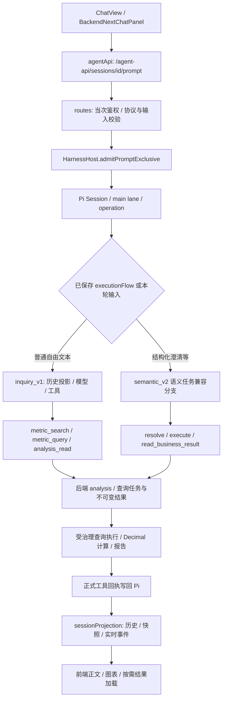

# 问数链路与质量基线

日期：2026-10-27。对应[待办任务10-27](待办任务10-27.md)的 T01/T02；第 1—8 节记录整改前事实、隔离回归和首次静态检查；第 9 节补齐运行确认，第 10 节记录 T03 第一批实施，第 11 节记录本轮结构化入场与旧执行退出。未声明 T03 整项或 T04—T08 完成。

## 1. 基线版本与范围

- 仓库：`ask-metric-v0.2-analysis-enhanced-windows`；分支 `develop-ws`，HEAD `93af51722a831a43fd0c67a4623394e154a67352`。
- 核对对象是 **HEAD 加本轮开始时的工作区内容**，不是纯提交版本。20:10 的初始快照有 9 个已跟踪文件修改、19 个未跟踪文件；均不得当成本轮新改动或撤销。
- 初始快照及完整差异留在本机 `/tmp/ask-metric-t01-t02-20261027/`：`before-status.txt`、`before-files.json`、`before.patch`。该目录为本次协作的临时审查证据，不是仓库长期备份。
- 本轮已有修改包括宿主交付预算、对应测试、业务知识与模型配置、聊天展示及其测试，以及工程约定和讨论文档。T01 只新增本文；T02 的配置、规约和检查改动另行审查。没有修改运行业务逻辑、切换参考分支、提交或推送。

初始已跟踪修改清单：

| 范围 | 文件 |
| --- | --- |
| 工程与记录 | `AGENTS.md`、`docs/Ask-Metric融合待办清单-2026-10-26.md` |
| Agent | `agent-service/src/harnessHost.ts`、`agent-service/tests/inquiryDeliveryBudget.test.ts` |
| 后端配置 | `backend-next/config/business-knowledge.json`、`backend-next/config/model-config.json` |
| 前端 | `frontend-vue/src/components/chat/BackendNextChatPanel.vue`、`CalculationResult.vue`、`frontend-vue/src/lib/toolCallSummary.ts` |

初始未跟踪内容包含 16 份文档、根目录 `pyproject.toml`，以及 `frontend-vue/specs/calculationResult.spec.ts`、`toolCallSummary.spec.ts`；精确文件列表以初始快照为准。不能因为这些文件未进入 Git 就忽略其当前行为。

## 2. 服务与配置：已确认事实和限制

本次只检查监听和不触发数据库访问的 `/health`，没有重启服务、调用模型或查询业务数据库。

| 项目 | 本次证据 | 能确认的范围 |
| --- | --- | --- |
| 前端 | `lsof -nP -iTCP -sTCP:LISTEN`：`127.0.0.1:5173` 有 Node 监听 | 端口存在；未进行桌面操作或构建产物核验 |
| 后端 | `127.0.0.1:8011` 有 Python 监听，`GET /health` 返回 HTTP 200、`{"status":"ok"}` | 进程存活；不等同于查询就绪、数据库可用或业务正确 |
| Agent | `127.0.0.1:8020` 有 Node 监听，`GET /health` 返回 HTTP 200、`{"status":"ok"}` | 进程存活；不等同于模型可用、鉴权通过或运行版本匹配 |
| 同机其他副本 | 同时存在 8010、8012、8021、5174 等监听 | 不能仅凭端口存在，把其他副本当成本仓库实例 |

普通沙箱首次访问本机 health 受网络限制；随后只读访问上述两个 `/health` 成功。未访问会检查数据库的 `/health/ready`。

对上述监听 PID 仅执行 `ps -p 22089,37973,15886 -o pid=,comm=`：Agent 和前端可执行文件均为 `/Users/deng/.volta/tools/image/node/24.14.0/bin/node`，后端为本仓库 `backend-next/.venv/bin/python`。该检查未读取进程参数或环境；解释器路径不能证明已加载的应用代码与当前工作区完全相同。

配置依据是磁盘文件白名单字段及加载代码；未读取进程环境、秘密、模型鉴权头或 Nacos 内容，因此首轮尚未确认进程启动环境覆盖和已加载版本；此缺口已在第 9 节补齐。以下表格保留首轮磁盘观察，不能覆盖第 9 节的运行结论。

| 配置入口 | 当前磁盘值或加载行为 |
| --- | --- |
| `frontend-vue/.env.local` + `vite.config.ts` | `/api` 指向本机 8011，`/agent-api` 指向 8020；正常聊天走 Agent，前端不会直接调模型 |
| `agent-service/.env` + `config.ts` | 模型 `deepseek-v4-flash`，`AGENT_MODEL_EXTRA_BODY` 的 `thinking.type=disabled`，正文临时流 `AGENT_ANSWER_STREAMING=false`；窗口 128000、输出上限 8192；首次有效输出/输出空闲时限均为 30000 ms，模型重试开启且最多 1 次 |
| 同一 Agent 配置 | `directQueryDelivery=on`、上下文及语义提示变体 `compact_v1`、工具选择策略 `native`；这些开关不能被解释为普通 inquiry 请求全部经过旧直接交付分支 |
| `agent-service/src/models.ts` | Pi 模型声明 `reasoning:false`，采样参数并入上述 `extraBody`；模型传输使用 Pi 流接口。浏览器正文临时流关闭不等于关闭模型传输流或关闭 SSE 进度 |
| `backend-next/.env` | `MODEL_CONFIG_PATH=.runtime/local-config/model-config.json`；按后端项目目录解析 |
| 后端上述本地配置 | chat 模型 `deepseek-v4-flash`，`enable_thinking=false`、`extra_body.thinking.type=disabled`、temperature 0、max_tokens 2048；embedding/reranker 关闭 |
| `backend-next/config/model-config.json` | chat 模型为 `deepseek-flash`，也关闭推理；与本地覆盖文件不同，不能将它直接当成本机运行值 |
| Nacos | Agent `loadRuntimeConfig()` 在启用时改从中心读取配置；后端也保留中心配置入口。本地文件未声明启用，不代表已排除进程环境覆盖 |

## 3. 整改前正式调用链

以下按实际代码核对。旧 README 的概括不代替入口判定。



| 阶段 | 入口和责任模块 | 条件、输出与边界 |
| --- | --- | --- |
| 页面请求 | `frontend-vue/src/views/ChatView.vue`；`BackendNextChatPanel.vue` 的 `handleSubmit → runQuestion → streamPrompt`；`lib/agentApi.ts` | 创建/选择服务端会话，携带请求 ID；SSE 提问与重连分开，取消经 `/sessions/:id/cancel` |
| HTTP 接纳 | `agent-service/src/routes.ts` | `/sessions`、`/sessions/:id`、`/prompt`、`/stream`；每次经后端 `auth/me` 校验身份；历史另核对来源权限。读取原生会话时可在当前认证下恢复未完成 operation，故本轮未调用会话 HTTP 接口 |
| 请求与执行绑定 | `harnessHost.ts` 的 `admitPromptExclusive`、`drivePrompt` | 同一 request ID 绑定 fingerprint 与 operation ID，已完成请求复用结果。普通文本且没有 `answers`、`clarification_target`、`selected_answers`、`clarification_selection`、`time_override` 时选择 `inquiry_v1`；重放沿用已保存分支 |
| 模型上下文 | `inquiry/history.ts`、`inquiry/view.ts`、`semantic-task/contextMemory.ts` | 最近三轮先鉴权再投影，本轮保留；保留成功交付的历史正文，并另行投影来源身份与条件。历史正文可能包含旧数值，但不能代替本轮正式事实引用，引用时仍须 `analysis_read` 重读；较早回指经 `session_history_read` 分页读取。机构、日期对应关系及截断标记不能丢弃 |
| 普通调查工具 | `inquiry/queryTools.ts` | `metric_search` 返回正式目录与签名绑定；`metric_query` 明确机构并解析日期，以 `execution_mode=inquiry` 调 `analysisExecute`；`metric_availability` 查真实覆盖；`analysis_read` 校验本会话运行来源与权限 |
| 查询和事实 | `backend-next/src/ask_metric/api/routes/analysis.py`；`application/analysis_execution.py` | `/api/v1/analysis/execute` → `GeneralAnalysisService` → `QueryTaskApplicationService.submit_question` → `QueryExecutionApplicationService.execute`；正式目录、机构权限、查询 DSL、SQL builder 和 MySQL/Inceptor 适配器控制取数。返回运行引用、任务、实际日期、单位和事实原子 |
| 计算 | `inquiry/calculationTool.ts` → `/api/v1/analysis/calculations` → `application/analysis_calculation.py`、`calculation_service.py` | 复用已授权事实和计算引用，使用 Decimal；不以模型手写数字替代计算结果。计算范围、输入来源与会话归属由后端核对 |
| 正文与图表 | `inquiry/reportTool.ts`、`chartTool.ts` → `/api/v1/analysis/report` → `application/analysis_report.py` | 自然正文由宿主转为 `analysis_answer`，引用映射为真实原子；后端重读来源并校验。图表引用已有结果，经 `analysis/reportCharts.ts` 生成；失败/部分结果与成功区分 |
| 实时与历史 | `sessionProjection.ts`、`routes.ts`、`answerStream.ts`；前端 `conversationFromDetail`、`handleStreamEvent`、`applyAgentSnapshot`、`hydrateResultTables` | 服务端按 entry/operation/tool-call 关联，输出 V3 投影；前端仍分别处理事件、快照、正文选择及表格加载。表格取后端结果快照，不从正文解析数值 |

## 4. Pi 与自研职责、状态拥有者

当前安装的 `@earendil-works/pi-agent-core` / `pi-ai` 均为 **0.85.1**。边界依据本地依赖声明、SDK 类型和本仓库接线核对，不推断其他版本的行为。

| 状态或职责 | 权威拥有者 | 自研代码的责任 |
| --- | --- | --- |
| transcript、lane、operation 接纳/执行/结果、原生重试与压缩 | Pi `AgentHarness`、`Session`、`JsonlSessionRepo` | `NativeSessionStore` 按认证用户隔离目录、单写保护、句柄与内存回收；不另建 transcript |
| 请求幂等和输入绑定 | `HarnessHost` 写入 Pi session values | request ID、fingerprint、operation ID、executionFlow 与请求关联；恢复时重建当前认证上下文 |
| 业务权限、来源可访问性 | 后端 actor、任务/会话归属和机构授权 | Agent 在历史投影、工具边界及模型 provider 前做撤权阻断，不能替代后端检查 |
| 语义任务、问题、业务帧与旧结果引用 | 自研 `NativeSemanticTaskStore`、`NativeFrameStore`、`NativeBusinessResultStore`，存储介质仍为 Pi session | 兼容分支中的业务状态，不是 Pi 自动理解和维护的银行业务目标；普通 inquiry 不调用语义任务 `admit()` |
| 分析运行、租约、查询结果、计算回执 | 后端应用服务与持久化单元 | `analysis_execution.py` 管运行幂等、租约、查询缓存及状态；查询任务与结果快照才是业务取数依据 |
| 本轮可交付证据与预算 | 工具回执；`inquiry/runtime.ts` 和宿主 hooks 解释 | 累计本轮工具回执达到 16 时收尾、最多两次回答尝试、总回执预算 18；交付成功后终止。属于当前行为基线，不说明每条限制都已合理 |
| 浏览器气泡、加载与取消控制 | 前端临时交互状态；最终内容源自服务端投影 | `AbortController`、当前会话、进度与表格缓存不作为业务执行或事实权威 |

Pi 原生能力与业务接线不能混称“全部由 Pi 负责”。`HarnessHost.registerHooks()` 当前仍承担以下行为：

| hook / event | 当前自研职责 |
| --- | --- |
| `before_request`、`usage`、`message_update`、`tool_end` | 计时、调用统计、输出状态、鉴权失败停止 |
| `before_payload`、`before_tool` | 工具视图、预算与准入；inquiry 和语义兼容分支分别决策 |
| `after_tool` | 回执后的终态判断；inquiry 交付失败收尾；兼容分支还有执行、结果读取、部分交付与直接交付 |
| `after_response` | 普通正文转工具交付、模型失败时按本轮证据恢复；兼容分支还有行动修复、补查及最终交付 |
| `transform_context`、`before_compaction` | 发送副本的权限过滤、业务知识/方法/机构及历史条件注入；压缩前检查。Pi 执行机制与自研业务裁剪是两个层次 |

## 5. 重复职责与兼容入口：去留待核

以下是首轮 T03—T07 的检查入口，当时尚未清理或迁移；T03 两批实现见第 10、11 节。存在兼容代码本身不等于缺陷，是否退出需核对调用方和历史记录。

| 当前事实 | 后续决策与最小回归 |
| --- | --- |
| `inquiry_v1` 与语义任务分支共用宿主，但分别处理工具选择、上下文、执行与收尾 | T03：明确结构化澄清能否转到统一入口；覆盖普通提问、已发布问题的点击、同 request ID 重放及未完成操作恢复 |
| `runtime/control.ts`、`runtime/delivery.ts`、`partialAnalysis.ts` 与 inquiry 预算、报告 fallback、宿主 hooks 分担交付和恢复 | T03/T06：按“准入、预算、恢复、最终答案”逐项确定唯一责任；保留权限失败停止及有限重试，不先整体删除 |
| `inquiry/history.ts` 的 `legacyQueryContext` 与 `queryTools.ts` 的 `legacyContext/queryContexts` 分别解释旧查询回执 | T04：统一边界转换之前先验证完整/截断旧事实、多机构异日、改指标/改日期及撤权；不能把一次投影成功视为执行条件一致 |
| `tools/index.ts` 仍组装语义、旧报告、partial/finalize 工具；旧 `createStructuredQueryTool` 还由 `business-context/adapters.ts` 调用 | T03：未对普通 inquiry 模型暴露不等于无调用方；禁止仅凭注册表删文件 |
| `legacySessions.ts` 读取旧 JSON；`HarnessHost.attach` 对 fixed_v1、无协议及已退役工具的原生会话标只读 | 维持历史可读边界，不能宣称旧会话都可继续追问。退出旧执行和删除历史是不同操作 |
| `analysis_execution.py`、`analysis_report.py`、`domain/value_presentation.py` 涉及计算展示与报告检查 | T05：已有待办记录布局相关引用校验、小额展示问题；本次不重现或修复，后续需同时覆盖应拒绝和应放行表达，不能照抄旧测试预期 |
| 服务端 `sessionProjection.ts` 已共用历史/实时映射；前端仍有历史重建、事件更新、终态整理等多条正文处理路径 | T07：先复用共同转换，再检查刷新前后正文、图表、失败提示、明细一致；本次 SSR 测试不能替代桌面验收 |
| 后端分析运行 `_claim/_save` 存在租约与恢复逻辑 | T06：并发风险目前仅是待核项；本次没有连接数据库做竞争复现，不能称已证实或已修复 |

## 6. 本次最小隔离回归

首轮时间约 20:13，Node 24 环境复验约 20:19（Asia/Shanghai）。测试读取当前 dirty 工作区，使用已有桩、临时 Pi JSONL 会话、内存存储替身及 Vue SSR，不调用真实模型或业务数据库，不写业务数据。记录的是代码契约测试，不是业务验收。下表为支持版本环境下的结果。

| 组 | 为什么选择 | 结果 | 测试框架耗时 / 墙钟 |
| --- | --- | --- | --- |
| Agent 7 文件 | 普通请求生命周期；近轮和旧回执条件；日期/机构继承；预算收尾；报告引用；重试历史投影 | **166/166 通过** | 1.41 s / 1.86 s |
| 后端 5 文件 | inquiry 查询保护；真实 Decimal 计算调用的隔离验证；跨机构/历史来源范围；空结果；报告恢复 | **59/59 通过**，1 条 Starlette/httpx 弃用警告 | 1.28 s / 1.80 s |
| 前端 3 文件 | 已有图表契约和 SSR；失败计算不混入业务正文；工具进度摘要 | **20/20 通过** | 1.11 s / 1.65 s |

可重复命令（各自子目录执行；墙钟使用 `/usr/bin/time -p` 包裹）：

```sh
# 使用已核对的 Node 24；下列路径为本机值，其他环境使用同一主版本的解释器
export PATH=/Users/deng/.volta/tools/image/node/24.14.0/bin:$PATH

# agent-service/
npm test -- tests/inquiryLifecycle.test.ts tests/inquiryHistory.test.ts tests/inquiryQueryTools.test.ts tests/inquiryRuntime.test.ts tests/inquiryDeliveryBudget.test.ts tests/inquiryReport.test.ts tests/sessionProjectionRetry.test.ts

# backend-next/
.venv/bin/python -m pytest -q -p no:cacheprovider verification/test_inquiry_analysis.py verification/test_inquiry_calculation.py verification/test_inquiry_report_scope.py verification/test_inquiry_empty_delivery.py verification/test_inquiry_report_fallback.py

# frontend-vue/
npm test -- specs/businessReportCharts.spec.ts specs/calculationResult.spec.ts specs/toolCallSummary.spec.ts
```

原始输出：`/tmp/ask-metric-t01-t02-20261027/t01-agent-node24-tests.log`、`t01-backend-tests.log`、`t01-frontend-node24-tests.log`。后端使用 `backend-next/.venv` 的 Python 3.11.15；Agent/前端复验使用 Node **24.14.0**，满足 Agent `>=22.12` 的声明。默认 shell 的 Node **20.20.2** 与运行服务不同，首轮在该版本也通过（Agent 1.83 s、前端 1.68 s），原日志保留为 `t01-agent-tests.log`、`t01-frontend-tests.log`；因解释器版本疑点才做同范围复验，没有扩大测试集。T02 的本地检查命令也须使用项目支持的版本。

## 7. 已有真实业务记录与后续对照样本

本节是**本轮只读核对的历史材料**，不是 10 月 27 日晚新发起的问数；未重新连接源库。仅保留业务条件、来源类别与状态，省略身份、会话 ID、金额和凭据。

| 记录 | 原问题及实际条件 | 实际来源、结果与局限 | 历史耗时 |
| --- | --- | --- | --- |
| 10/27 P1 | “我行最近存款情况如何？”；账号机构为省级汇总。第一批 latest_snapshot 得到 2026-08-27，第二批 exact 沿用该日；覆盖总存款及三个比较指标、个人/对公余额与占比 | `P1.json` 有两次 `metric_query`、两个 analysis 运行，各自 `query_count=4`，合计 8 个任务。不能把两次工具调用说成两条 SQL。首次 `analysis_answer` 为 `ARGUMENT_ERROR/ANALYSIS_REPORT_NUMBER`，第二次 `business_report.succeeded`。来源回执可读，但本次未核对底层表值；既有总结仍记录一次重写、数字重复和比较基期表达问题，成功状态不能代表业务表达完全正确 | 原生摘要 36.998 s；采集器 37.131 s，计时边界不同 |
| 10/24 A1 | “看看我们行现在存款有多少。”；默认账号机构、实际日 2026-08-27 | 历史核源文件记录总存款 1 行、检查通过；当时源库为用户指定的本机 3309/ads_lake。只证明当时实际执行范围 | native 25.259 s |
| 10/24 A2 | 上题后问“个人的呢？” | 历史记录 `previous_task_result_reused=true`，继续使用上一轮总存款，未完成个人存款目标；最终 partial 工具成功不能当作追问正确。作为“应改变指标、保留其他条件”的反例，不能沿用该错误为预期 | native 30.081 s |
| 10/24 D2 | 个人/企业比较后问“都按上个月底看。”；运行日对应 2026-09-30 | 历史查询 0 行且核源通过；当时正确说明无数据，不应把 2026-08-27 的数据替换成所问月末。作为缺数与执行失败的区分样本 | native 7.129 s |

原始证据在忽略目录：

- `.runtime/local/performance-20261027/P1.json`、`outcomes.json`、`performance-summary.json`、`run-manifest.json`：本次核对了条件、任务数量、工具状态和计时；其中“历史 50.808 s → 当前 36.998 s”仍只是一次既有对照，不能证明稳定提升，也不计算 P95。
- `.runtime/local/natural-business-20261024/collected.json`、`source-verification.json`、`source-special-checks.json`：A1/A2/D2 的原话、计时、工具和取数核验可追溯。该轮为 `develop@cb1593d39c53bcc7ee09da82ef17539464465ac8`、`deepseek-v4-pro`；与当前代码/模型不同，缺陷是否仍存在须按受影响类别复测。
- 本地历史材料 `docs/业务自然问法新版实测记录-2026-10-24.md` 与 `docs/业务表达与饼图验证-2026-10-25.md` 保留更广历史范围，未纳入本轮代码整改提交；本次未重做其中源库和桌面核验。

后续按改动选择上述样本，加上隔离用例中的撤权、截断旧回执、多机构异日、未知单位、负数、小额、无基期及失败恢复。真实验收必须同时比较目标、实际条件、来源和最终表达；旧值不作为当前数据库的固定预期。

**首轮未验证：** 运行配置与源码对应关系已在第 9 节补齐，Agent 全量隔离测试结果见第 10 节；真实模型可用性、数据库查询就绪及源值、桌面实时/刷新/取消交互、数据库并发恢复仍未验证。后续性能复测还需固定模型、推理和流配置、数据条件、缓存状态及代码版本，并分别记录模型、查询、计算、正文修正和显示耗时。本文建立可复查基线，不宣布问数链路整体正确或 T03 以后的整改完成。

## 8. T02 本地检查及首次结果

用户确认尚未配置 CI，本阶段先提供本地入口；没有新增流水线、Git hook 或自研质量审核框架。具体开发约定与命令见[开发规约](开发规约.md)。统一入口 `python scripts/check_quality.py` 只编排现有工具，任一检查失败即返回非零，不自动修复、不写业务数据。

检查使用 Node 24.14.0 / Python 3.11.15。新增开发工具固定版本：ESLint 10.13.0、typescript-eslint 8.72.1、Prettier 3.9.10、Vue 插件 10.12.0、mypy 2.4.0；Ruff 0.16.8 沿用原锁。ESLint 10 当前受维护，本地检查至少使用 Node 22.13 的 22.x 或 24.x；原生产 engines 声明保持不变。版本依据见 [ESLint 支持周期](https://eslint.org/version-support/)与[运行环境要求](https://eslint.org/docs/latest/use/getting-started#prerequisites)。

| 模块 | 实际检查范围 | lint | 类型检查 | 格式检查 |
| --- | --- | --- | --- | --- |
| Agent | ESLint 221 文件：src、tests、scripts 及配置；原有两个 tsc 配置保留 | 3662 条，134 文件；运行源码 315、测试 1055、辅助脚本 2292 | 通过，0 诊断 | 219 文件待整理 |
| Vue | ESLint 79 文件：src、specs、Vite 与 ESLint 配置；原有 vue-tsc 保留 | 94 条，23 文件；运行源码 77、测试 17 | 通过，0 诊断 | 70 文件待整理 |
| 后端 | Ruff 覆盖 src、scripts、verification、alembic_goldendb、conftest，共 161 文件；统一入口再含新增两个根检查脚本。mypy 默认仅 src 的 116 文件 | 106 条，19 文件 | 303 条，52 文件 | 108/161 文件待整理；新增两个检查脚本已通过 |

以上是当前工作区按新配置报告的静态诊断，**不是同等数量的已发生业务故障**。统一入口九项检查全部执行，两项 TypeScript 类型检查通过，其余因表中既有问题失败，整体退出码为 1；未使用忽略基线、全局类型豁免或批量格式化来消除结果。

分类与整改顺序：

1. 优先结合 T03—T07 的实际调用链处理运行源码中的未处理 Promise、错误与取消路径、不安全类型边界、可空值及参数契约。Agent 有 11 条 Promise 相关诊断，Vue 有 31 条未处理 Promise 诊断（含测试范围）；需逐项核实生命周期，不能统一加 `void` 消音。mypy 主要为可空属性访问 69、参数类型 53、赋值 32、索引 30，优先确认是否影响真实行为。
2. 随对应模块整改测试与辅助脚本的类型和异步用法。Agent 大部分诊断位于这两类文件，不能把它们当作主流程有 3662 个缺陷，也不能整体排除来通过检查。
3. 导入和格式单独整理。Ruff 为 E501 99、I001 5、F401 1、B905 1；格式化不保证消除所有长字符串或长注释问题。避免将全仓格式变化混入行为修复。

当前范围之外：后端脚本、迁移和 verification 尚未纳入 mypy；渐进模式未要求每个函数均有注解，外部缺少类型声明的依赖仍有 6 条 `import-untyped`，其内部没有完整类型保证。根目录其他运维脚本与存量 Markdown 未纳入这三个包的静态检查。Windows、本机以外的 Node/Python 版本未实测。

工具本身的验证：

- TypeScript/Vue 的六组正反样本验证了未处理 Promise（含 `void`）、Promise 误用、不安全赋值/成员访问和 Vue await 后生命周期/监听注册；Python 样本验证了返回值、赋值、参数类型及无注解函数体检查。样本仅供静态检查，不是业务演示数据。
- 统一入口 5 项隔离回归通过：失败传播、缺工具后继续、带空格工作目录、空检查拒绝、相对解释器路径保留虚拟环境。新增检查脚本自身 Ruff 与 strict mypy 通过；新增 ESLint/Prettier 配置单独格式检查通过。
- 两个 Node 锁文件的所有原有包版本及生产依赖声明未变；Python 的 72 个生产依赖版本、来源、关系未变。uv 仅新增 mypy 及 4 个依赖、补齐同版本 greenlet wheel 元数据。开发环境同步恢复了原锁定的 Ruff/pytest 辅助依赖，并新增 pytest-asyncio；没有移除额外包。同步后重新运行同一后端子集：59/59 通过，1 条原有弃用警告，框架耗时 1.05 s。

首次报告位于 `/tmp/ask-metric-t01-t02-20261027/`：`local-quality-full.log`、`ts-vue-summary.json`、`python-quality-summary.json`、规则正反样本记录、`runner-tests.log`、`t01-backend-after-tools-tests.log` 及依赖差异核对。临时目录可能被系统清理，因此本节保留长期可追溯的范围、版本、结果和复跑入口；完整明细可用同一命令重新生成。


## 9. T01 运行基线补齐（21:18—21:31，T03 修改前）

本次从启动参数、完整初始环境的覆盖键存在性、文件时序、配置加载实现、当前 PID 日志及构建内容交叉核对。未转储进程内存、未注入探针、未重启、未调用模型、数据库或会话接口；离线 loader 投影只作为启动证据链的一部分。

| 实例 | 确认结果 |
| --- | --- |
| Agent PID 22089，16:13:18 启动 | Node 24.14.0，`--env-file=.env dist/server.js`，并非源码热更新。源码、配置与 dist 均早于启动；以当前编译器输出到临时目录，122 个文件与现有 dist 逐字节一致。模型 `deepseek-v4-flash`，推理关闭，正文临时流关闭 |
| 后端 PID 15886，15:24:09 启动 | 本仓库虚拟环境，`ask_metric.main:app`，无 reload；实际还加载 `--env-file ../.runtime/local/import-20261023/backend.env`，然后才由 Settings 补充项目 `.env`。因此应用库方言 mysql，查询库方言 **inceptor**；后者与当前 PID 启动紧邻日志一致，不能把主 `.env` 独读的 mysql 当运行值 |
| 后端模型仓库 | 实际路径 `backend-next/.runtime/local-config/model-config.json`。chat `deepseek-v4-flash`、推理关闭、max_tokens 2048；不是 Git 跟踪的 `config/model-config.json` |
| 前端 PID 37973，10/25 17:26:57 启动 | Vite 动态服务；四个关键模块的在线 source map 内容与当前工作区相同，含聊天组件、计算结果、工具摘要和 Agent API。没有将此检查当作浏览器视觉/交互验收 |

三进程初始环境均已实际取得并只保存覆盖检查结果，没有应用配置键覆盖；Nacos 关闭。Uvicorn 的 env-file 在进程启动后加载，不能仅靠初始环境排除它。后端源码、启动覆盖和模型文件均早于当前进程启动。两个 `/health` 和前端代理健康响应正常，仅证明存活。

证据位于本机 `/tmp/ask-metric-t03-20261027/runtime-confirmation.md` 及同目录 `runtime-*.json`，不含凭据或完整环境。T03 前源码/构建指纹已保存；修改后不能继续用这些指纹声称新代码已加载。

## 10. T03 普通 inquiry 收敛与旧代码退出（第一批）

MFWS 参考为 `text-to-sql-agent-release` 的 `jjccb-release@846a49b` 已提交实现：借鉴单一 agent 循环、根据工具结果调查、共用取消信号及有限恢复的职责安排；没有复制其关键词拦截和正文数字改写。

| 处理 | 实现与理由 |
| --- | --- |
| 集中普通 inquiry 决策 | `inquiry/runtime.ts` 统一 payload、准入、持久回执预算、after_tool 完成、after_response 收尾和失败恢复；没有第二个内存计数器。宿主保留 Pi 生命周期、日志/审计/计时和 hooks 接线 |
| 工具与恢复分工 | `reportTool.ts` 只作一次正式来源转换及后端校验。runtime 注册的 `createInquiryAnswerTool` 在第二次正文 NUMBER 错误时调用一次事实恢复，仍用同一来源/历史关注范围/计算引用和图表校验。第一次错误仍可修正，来源/权限失败不能借此放行 |
| 退出无调用实现 | 删除 `queryContext.ts`、`tools/answerPresent.ts`，移除 `queryCandidate`、`selectEvidence`、`requiresCatalogAction`、旧 resolve/read 工厂、`createEvidenceRepairTool` 及注册。限定 src/tests/scripts，以 `rg --no-ignore` 和文件枚举核查静态/动态引用 |
| 去掉重复路径 | 删除宿主重复 24 次工具预算判断（已有 runtime/control 等价保护）、前置多 resolve 拦截之后的不可达批次分支；普通 inquiry 不再读取只服务旧工具视图的 followupEvidence |
| 保留必要兼容 | `presentedAnswer` 和旧回执投影继续支持历史读取；semantic、partial、structuredQuery、direct delivery 等仍有实际消费者，未凭注册表或文件名称删除 |

本批没有改工具公开名称、HTTP/回执契约、Pi JSONL、数据结构或配置；没有新增提示词、句式正则、依赖和通用恢复系统。已删除模块的职责不是挪到另一套执行框架。

第一批结束时的迁移缺口（本轮处理见第 11 节）：前端发送时间覆盖和旧结构化选择；`time_override` 在语义服务中具有可信优先级，而 inquiry 查询只有模型未给日期才采用它，不能直接改路由。`clarification_target/selected_answers` 的结构化消费尚未确认；API 的 `answers` 另有问题版本和发布证明保护。旧在途请求必须沿原关联恢复，fixed_v1/退役会话仍只读。后续先迁移这些真实调用方，再退出语义执行；不得改写历史 executionFlow 掩盖兼容差异。

验证：

- 新增“报告工具不依据旧回执自行重试”的测试先失败（实际两次后端调用），分离职责后通过。
- 首轮针对性回归 10 文件、119 项通过；随后新增共享预算、旧轮隔离、取消和计算身份恢复边界，全量 Agent **60 文件、933 通过、1 跳过**，耗时 4.35 秒。跳过项为既有用例；耗时是隔离测试耗时，不是模型响应速度。
- `npm run typecheck` 同时覆盖运行源码与测试配置；两个完整整改模块 `src/inquiry/runtime.ts`、`src/inquiry/reportTool.ts` 的 ESLint/Prettier 通过。存量其他模块的全仓 lint 债务未清零，未新增忽略规则。
- 独立评审核对 Pi 在 `after_tool` 后才持久化回执的时序、同批 terminate、权限/取消传播、计算与来源保护及死代码消费者，未发现本批阻断问题。
- 未重跑真实模型问答、数据库取数或桌面操作，不能声称自然回答、准确性和性能已经达到 MFWS，也不能将本批当作完整 T03 验收。

测试完整输出：`/tmp/ask-metric-t03-20261027/agent-tests.log`。本批改动不需要迁移业务数据，回退只需恢复本批源码并重建 Agent；不回写会话、不撤销用户原有改动。提交与推送未执行。


本批运行更新：构建通过后清除两个已删除模块对应的旧 JS 产物；确认 220 个会话文件最后写入仍为 15:58:23、Agent 无活动连接后，用原有 `restart-new.py agent` 重启。新 PID **44248**，Agent 与 Vite 代理 `/health` 均返回 200/ok；构建输出 120 个 JS。后端和前端没有重启，模型配置未变。构建摘要及健康记录见 `/tmp/ask-metric-t03-20261027/runtime-after-t03.json`。健康检查不代表真实业务验收。


## 11. T03 结构化入场与旧执行退出（工程迁移完成）

新请求统一进入 inquiry；`executionFlow` 继续保留真实历史身份，不通过改写旧关联伪装已迁移。兼容边界转换原有输入和历史记录，不再调用旧语义执行器。

| 边界 | 本轮实现 |
| --- | --- |
| 时间切换 | HTTP `time_override` 优先于模型日期；保留指标、机构与历史期间分组，交给正式后端查询契约执行 |
| 问题和 Frame 选择 | `inquiry/admission.ts` 只读原存储，核对当前分支发布证明、actor/会话归属、问题版本、状态和选项；保留多目标身份、完整候选组及来源确认范围。拒绝、未回答和只能识别基础指标的选择保留未决状态，不推定默认机构或正式指标 |
| 后端旧任务选择 | 按真实前端 `selected_answers` 形状适配，先核对当前分支的 task 发布归属，再经 `getTask` 权限、task.version 与 clarification.id 核验；选中编码及已理解条件重新走正式字段解析。不能证明身份或不支持的历史形状返回明确兼容错误 |
| 执行条件与消费 | 接纳条件及 answer receipts 冻结在已有 RequestAssociation；同请求重放沿用冻结条件。消费以当前分支的已接纳请求关联为准，重复回答不能再生成操作；前端问题状态投影同步消费结果。同目标分轮回答从当前父链恢复已受理选择，重新校验最新版本、发布证明和权限，不回写旧账本。查询按 target_ref 绑定指标、机构、日期，以及旧独立 selection/operation 中的区间取数方式、排名方向和数量；非法或矛盾条件保留未决 |
| 指标批次 | 保留旧目标最多 100 个指标，目录重绑定最多 8 路并发，按后端既有每计划 32 个、每步骤 12 个上限拆分。单计划回执保持原结构，多计划复用 semantic_results，保留各 run_ref 与引用。服务失败保留成功批次，重试只执行缺少回执的批次并复用幂等键；当前目标全部指标完成取数前不开放独立补查。权限失败与取消仍沿既有出口停止，不借部分成功绕过 |
| 旧操作 | 原 inquiry 操作保留原关联恢复；旧语义操作明确中断并提示另起一轮，不续跑旧工具，不回写历史 executionFlow。旧只读会话与历史结果仍保留资源和权限核对 |
| 旧入口退出 | 宿主和工具注册只保留 inquiry；删除旧 semantic 工具/提示、analysis/model view、enhanced prompt、finalize、capability 及孤立回归。进一步解除历史快照读取夹带的旧执行依赖：删除 SemanticPlanService/TaskService、Frame 执行/对账与旧注册、字段解析/计划修复闭环、旧目录/计算/概览工具及其孤立代码；保留版本化答案快照读取、历史阶段解析、存储类型、业务日期与幂等 hash，当前查询/计算/报告/图表统一使用 inquiry |

迁移前只读数据盘点：220 个会话、391 个请求，其中 316 个没有 inquiry 执行标记，75 个为 inquiry；所有请求均是普通 message，没有结构化选择或时间覆盖，未发现活动旧操作。历史问题版本仍含 open/answered/rejected/superseded 和 base_only 选项。这说明兼容读存储仍有用途，但不能据此声明实际旧点击、时间切换或中断恢复已验收。

已取得的本轮证据：先建立失败测试再修复入场、批次与分轮续接；入场适配 44 项、查询工具 115 项回归通过。分轮确认使用真实 Pi 持久化与新宿主重开，覆盖正常续接、卡片换版和机构撤权。退出文件已用限定 src/tests/scripts 的 `rg --no-ignore`、导入调用图核查，README、部署和现行检查入口没有引用已删除脚本。本轮累计删除 47 个旧源文件、21 个纯旧测试和 15 个旧脚本；3 个报告混合套件迁到 inquiry 后 71 项通过，保留权限、来源及图表算法回归。历史纯类型和快照读取继续保留，未以旧工具测试反向保留执行入口。

最终 `npm test` 为 **47 文件、733 项通过，0 失败、0 跳过**；`npm run typecheck` 覆盖源码和测试，`npm run build` 通过。Vue 类型检查已通过，本轮未修改前端。15 个核心生产模块 ESLint 零错误/告警，新增及相关测试局部 ESLint/Prettier 通过，`git diff --check` 通过；全仓历史 lint 债务未在本轮清零。证据保存于 `/tmp/ask-metric-t03-complete-20261027/` 的 `test-complete.json`、`lint-final.json` 和 `runtime-final.json`；临时目录可被系统清理，本节保留最终范围与结果。

运行更新：确认没有活动查询后，按原启动命令仅重启 Agent，清除与已删除源码对应的 47 个旧编译模块；新 PID **83496**，75 个 JS 模块，构建摘要 `18cb8ef73b4f7bd06f117b9491eff1c728e9c38be2af40e4d9e68c64fb4fc081`。Agent 及 Vite 代理健康检查均为 200/ok。后端、前端、模型配置及业务知识文件保持本轮开始时内容；继续使用已有 deepseek-v4-flash、关闭推理和正文临时流配置。未修改业务数据或旧会话账本。回退为恢复对应源码并重新构建、重启 Agent，不自动重放已中断的旧操作；历史数据保留。

限制：本轮尚未重跑真实模型/数据库查询及桌面操作；测试中的受控边界返回只用于隔离契约验证，不是业务数据或实际验收。未实现 T04—T08 的上下文统一、报告规则重构、数据库并发恢复与性能目标。没有新增工作流框架、自然语言词语补丁或业务数据迁移，也未提交或推送。
