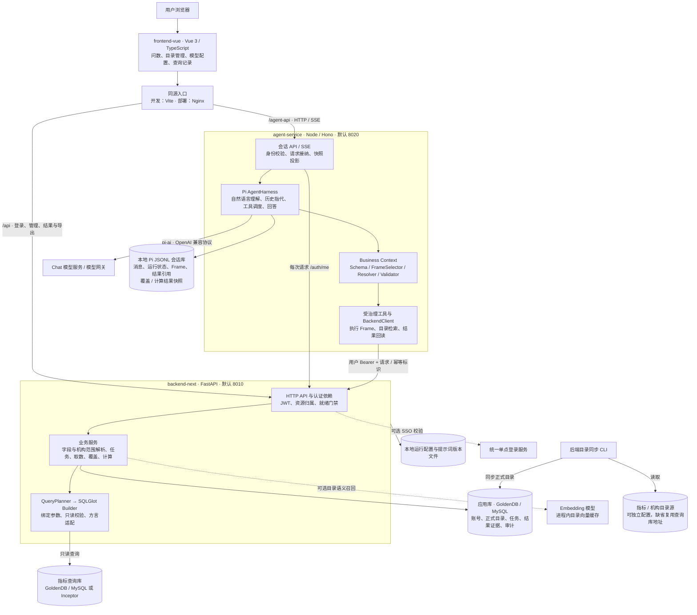
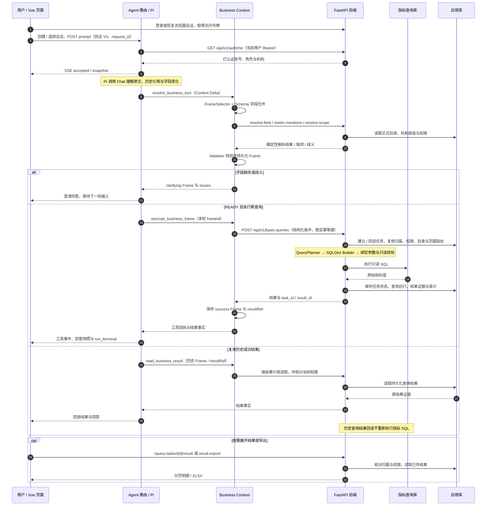
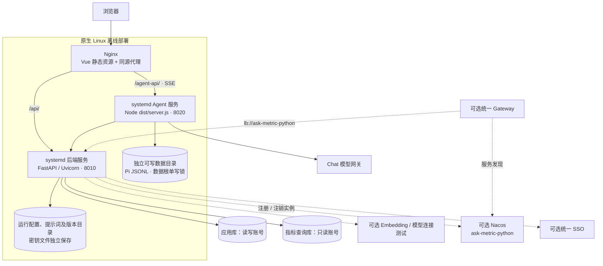

# Ask Metric 当前项目架构

本文依据当前源码、路由注册、工具注册和部署模板绘制，核对日期为 2026-10-09。描述的是仓库已实现的结构，不代表当前机器或生产环境已启动全部组件。图中虚线表示可选集成或辅助关系。

系统采用三个独立应用：Vue 前端、Node/TypeScript Pi Agent 服务、Python/FastAPI 后端。自然语言理解和多轮会话由 Pi 编排，可信业务状态由 Business Frame 管理，权限、目录、查询规划、SQL 构建、业务取数及计算由后端执行。

## 1. 总体架构

前端有两条不同职责的请求通道：对话与会话走 `/agent-api`，登录、管理、查询结果分页和导出走 `/api`。生产 Nginx 转发 `/agent-api/` 时剥离前缀并关闭 SSE 缓冲；Agent 调后端使用独立 `BACKEND_BASE_URL`。

模型调用也有两条配置路径：Agent 的 Chat 使用 `AGENT_MODEL_*` 配置，后端模型配置用于目录 Embedding 及模型连接测试等能力。当前业务查询不调用 Chat 生成 SQL，后端管理页配置不自动改写 Agent 的模型环境变量。Reranker 接入仍保留，但当前源码调用点在模型连接测试中，不应画成主查询必经步骤。

## 2. 内部模块与职责

```mermaid
flowchart LR
    subgraph Vue["前端"]
        View["ChatView / 管理页面"] --> Panel["BackendNextChatPanel<br/>消息、澄清、重连、工具进度"]
        Panel --> AgentAPI["lib/agentApi.ts<br/>会话 / prompt / stream / cancel"]
        View --> BackendAPI["lib/api.ts<br/>认证、目录、配置、查询日志"]
        Panel --> BackendAPI
        Panel --> Display["ChatResultContent / Chart / CalculationResult<br/>表格、图表、计算证据"]
    end

    subgraph Agent["Agent 业务编排"]
        Host["routes.ts → HarnessHost<br/>Pi main lane、压缩、恢复、工具治理"]
        Delta["resolve_business_turn<br/>能力、历史引用、Context Delta"]
        Context["BusinessContextService<br/>历史选择、字段合并、解析与验证"]
        Ready["execute_business_frame<br/>只接受本轮 READY frameId"]
        Adapter["BusinessToolRegistry<br/>取值 / 覆盖 / 计算适配器"]
        Read["catalog / read / read_business_result<br/>目录、历史与结果回读"]
        Host --> Delta --> Context --> Ready --> Adapter
        Host --> Read
        Context --> Store["NativeFrameStore<br/>事务 values、版本校验、焦点、幂等"]
    end

    subgraph Python["后端分层"]
        HTTP["api/routes + dependencies<br/>请求契约、鉴权、依赖装配"]
        App["application<br/>任务、查询执行、目录解析、结果、计算"]
        Domain["domain<br/>BasicQuerySpec、QueryPlanner<br/>机构范围、时间表达式、Decimal 计算"]
        Infra["infrastructure<br/>SQLAlchemy UoW / 仓库<br/>SQLGlot、查询驱动、模型 HTTP、导出"]
        HTTP --> App --> Domain
        App --> Infra
        Domain -.->|"部分模块存在直接依赖"| Infra
    end

    AgentAPI --> Host
    BackendAPI --> HTTP
    Adapter --> Client["BackendClient<br/>透传用户 Bearer"] --> HTTP
    Read --> Client
    Context -->|"确定性字段 / 范围解析"| Client
```

| 模块 | 主要职责 | 关键入口 |
| --- | --- | --- |
| Vue 前端 | 页面导航、认证状态、问数输入、SSE 消费、结果展示、管理操作 | `frontend-vue/src/router/index.ts`、`components/chat/BackendNextChatPanel.vue`、`lib/agentApi.ts`、`lib/api.ts` |
| Agent HTTP 层 | 会话管理、协议 V3、每次请求身份校验、取消、重连与页面投影 | `agent-service/src/server.ts`、`routes.ts`、`sessionProjection.ts` |
| Pi 宿主 | 原生会话与 main lane 接线、模型调用、上下文压缩、工具治理与运行恢复 | `agent-service/src/harnessHost.ts`、`models.ts`、`modelContext.ts` |
| Business Context | 能力 Schema、字段变化、历史分支与焦点、解析验证、Frame 状态转换 | `agent-service/src/business-context/{capabilities,core,service,resolvers}.ts` |
| Agent 工具层 | 注册模型可用工具，将已验证 Frame 转为后端契约，按引用回读结果 | `agent-service/src/tools/index.ts`、`tools/businessContext.ts`、`business-context/adapters.ts`、`backendClient.ts` |
| 后端 API 层 | Pydantic 契约、认证依赖、就绪检查和业务服务装配 | `backend-next/src/ask_metric/api/router.py`、`api/dependencies.py`、`api/routes/` |
| 后端应用层 | 任务幂等、权限复核、取数编排、目录解析、受控计算与结果追溯 | `application/task_service.py`、`query_execution_service.py`、`field_resolution.py`、`calculation_service.py` |
| 后端领域层 | 查询结构与能力边界、查询计划、机构范围、时间解析及精确计算规则 | `domain/basic_query.py`、`query_execution.py`、`organization_scope.py`、`time_expression.py`、`calculation.py` |
| 后端基础设施 | 数据库连接与事务、SQL 构建与只读驱动、模型配置、文件配置、服务发现和 XLSX 导出 | `infrastructure/db/`、`query/`、`model/`、`discovery/`、`export/` |

上述后端分层是当前职责划分，不是完全隔离的依赖结构。部分 `domain` 模块直接引用 `infrastructure`；图中保留这一事实。

当前注册能力包含 `metric_query`、`data_availability`、`metric_calculate`。排名属于 `metric_query.operation`，时间选择由独立的 `selection` 表达。目录检索和业务技能读取是辅助工具，不绕过 READY Frame 的执行边界。启动时还注册 `business_skill_read`，工具集合也包含 `respond_without_business_action` 与 `business_action_required`。

## 3. 一次问数与历史复用的时序

该时序以基础取值为例。覆盖查询经 `/data-availability` 使用受治理查询链；表达式计算经 `/calculations` 读取授权结果事实，由 `Decimal` 和受限表达式执行器完成，计算证据保存在后端。覆盖和计算的 Agent 工具快照还在 Pi 会话 values 中独立保存，Frame 只携带引用和摘要。

SSE 用于运行事件与快照，不能把任一中间工具成功视为整轮完成。回答流式开关开启且前端声明支持时，另有 `answer_delta` / `answer_reset`；临时正文可撤回，最终以快照为准。刷新后使用 GET 观察流恢复，不自动重发 POST 提问。

## 4. 存储与部署边界

| 存储 | 内容与边界 |
| --- | --- |
| 应用数据库 | `app_users`、指标与机构正式目录、数据集元数据、`query_tasks`、`query_runs`、兼容会话消息及结果/计算证据。使用独立读写连接。 |
| 指标查询数据库 | 真实指标取数与数据覆盖的只读数据源；方言适配器支持 MySQL 与 Inceptor。与应用库是不同逻辑连接，不能默认视为同一账号或物理实例。 |
| 目录源数据库 | 指标与机构可分别配置源连接；未配置时复用查询数据库 URL。目录同步由后端 CLI 执行，将正式目录写入应用库。 |
| Pi 本地会话库 | `AGENT_DATA_DIR/native-v1/u_<身份哈希>/` 下的原生 JSONL 会话，保存消息、运行状态、业务 Frame、焦点、幂等关联以及覆盖/计算工具快照。当前用户令牌只驻留内存。 |
| 文件配置 | 后端模型/提示词/语义配置及提示词版本等保存在本地文件，Agent 使用自己的环境配置与业务提示词/技能资源。敏感环境项可通过独立 SM4 主密钥解密。 |
| 进程内缓存 | 后端共享 HTTP 客户端、模型并发信号量、目录匹配索引与可选目录向量缓存；前端目录选项也有页面级缓存。当前实现不依赖独立 Redis 或向量数据库。 |

默认本地开发入口为 Vite `5173`、FastAPI `8010`、Agent `8020`。端口可配置。原生离线构建、安装、升级和回滚入口在 `deploy/package/`；另有 `deploy/cloud-next/compose.yaml` 提供容器部署，应用关系仍为前端、后端、Agent 三个服务。

Agent 的同一数据根只允许一个写实例，不能按无状态服务方式直接增加多个共写副本。后端进程内索引与向量缓存不跨 worker 共享，每个进程分别初始化。数据库迁移使用 Alembic，离线包安装不会自动执行迁移。

## 5. 架构判断与源码依据

1. **主问数入口是 Pi 会话。** `ChatView` 装载 `BackendNextChatPanel`，该面板调用 `agentApi`；组件旧名称不能作为旧后端自然语言链路仍在运行的依据。
2. **多轮上下文在 Agent 管理。** 后端每次 `basic-queries` 接收独立结构化条件；历史指代、分支与焦点由 Agent Business Frame 编排。
3. **模型输出不直接成为可执行 SQL。** 执行工具仅接收已验证 Frame，后端再次复核权限、目录、范围和计划，再由 SQLGlot 确定性构建 SQL。
4. **结果复用仍校验当前权限。** 历史查询结果读取后端快照；覆盖/计算的 Agent 快照回读也会重新校验目录、机构和来源任务。
5. **历史表或旧工具文件不等于在线能力。** 旧后端自然语言接口、旧 Agent 执行工具及归因流程不在当前主链路中；迁移、历史模型与只读兼容仍可能保留。
6. **当前前端页面按路由注册判断。** 已注册登录、问数、查询记录、模型配置、指标、机构、数据集；不将 README 中遗留的准确率页面等描述纳入当前架构。

直接核对入口：

- [前端路由](../frontend-vue/src/router/index.ts)、[问数面板](../frontend-vue/src/components/chat/BackendNextChatPanel.vue)、[Agent API 客户端](../frontend-vue/src/lib/agentApi.ts)。
- [Agent 启动](../agent-service/src/server.ts)、[HTTP 路由](../agent-service/src/routes.ts)、[Pi 宿主](../agent-service/src/harnessHost.ts)、[原生会话仓库](../agent-service/src/nativeSessions.ts)。
- [工具注册](../agent-service/src/tools/index.ts)、[Business Context 工具](../agent-service/src/tools/businessContext.ts)、[能力注册](../agent-service/src/business-context/capabilities.ts)、[Frame 持久化](../agent-service/src/business-context/store.ts)、[后端客户端](../agent-service/src/backendClient.ts)。
- [后端启动](../backend-next/src/ask_metric/main.py)、[路由注册](../backend-next/src/ask_metric/api/router.py)、[依赖装配](../backend-next/src/ask_metric/api/dependencies.py)、[查询 API](../backend-next/src/ask_metric/api/routes/tasks.py)、[业务字段解析 API](../backend-next/src/ask_metric/api/routes/business_context.py)。
- [查询执行服务](../backend-next/src/ask_metric/application/query_execution_service.py)、[计算服务](../backend-next/src/ask_metric/application/calculation_service.py)、[SQL Builder](../backend-next/src/ask_metric/infrastructure/query/sql_builder.py)、[只读 SQL 校验](../backend-next/src/ask_metric/infrastructure/query/sql_safety.py)、[数据库连接](../backend-next/src/ask_metric/infrastructure/db/session.py)。
- [开发代理](../frontend-vue/vite.config.ts)、[Nginx 部署模板](../deploy/package/runtime/nginx.conf.template)、[Agent systemd 模板](../deploy/package/runtime/ask-metric-agent.service.template)、[容器编排](../deploy/cloud-next/compose.yaml)。

本次核对只读取源码和部署模板，没有连接真实模型、应用库、数据湖或生产服务；真实环境的组件启用状态、地址、性能和业务数据需在对应环境另行验证。
